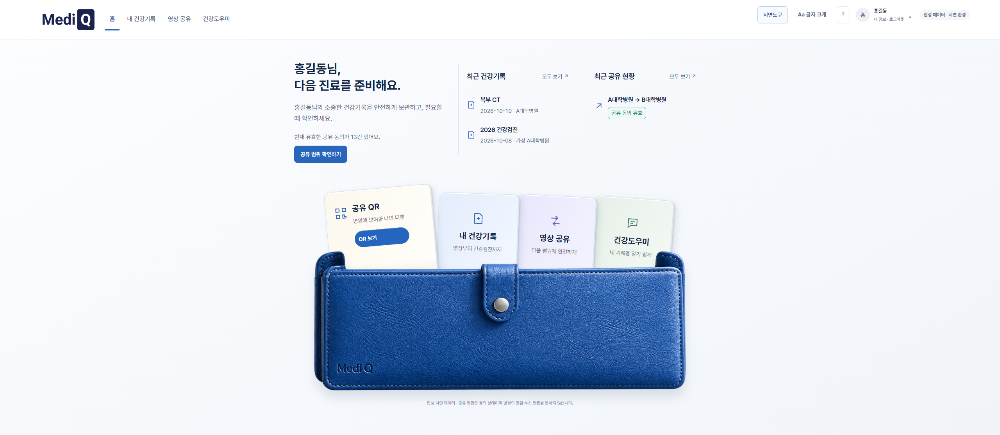
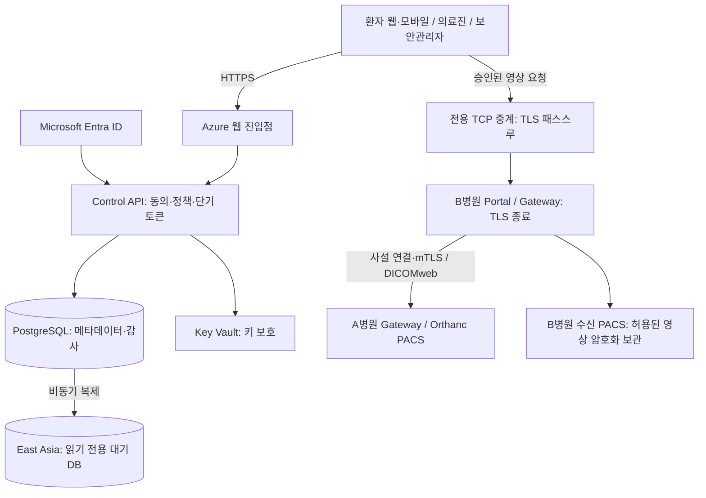
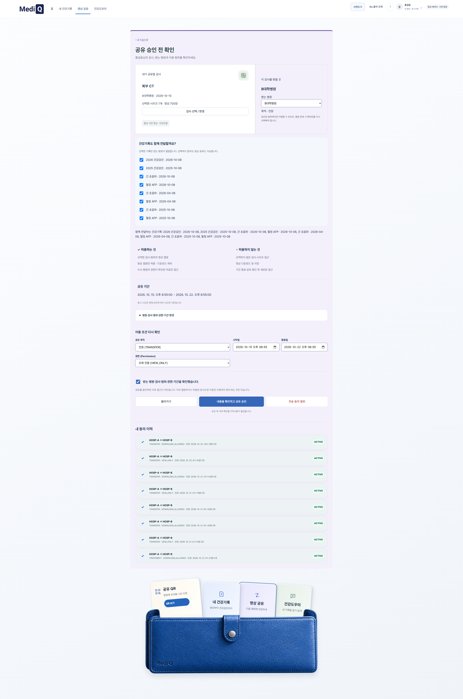
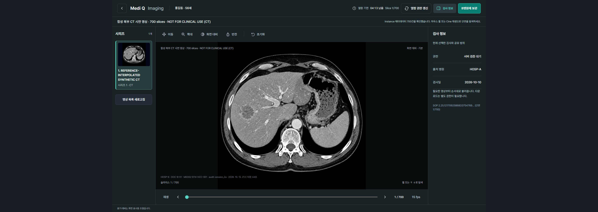

# Medi Q · 하이패스 Platform

환자가 공유할 검사와 병원을 선택하고, 의료진이 승인된 범위의 영상을 조회하는 의료영상 공유 MVP입니다. 합성 환자와 가상 병원 A/B, Orthanc PACS로 시연합니다.

**[프로젝트 둘러보기](https://sureasdufo1-hue.github.io/Highpass-Project/)** · **[Medi Q 직접 체험하기](https://sureasdufo1-hue.github.io/Highpass-Project/demo/)** · **[환자로 체험하기](https://sureasdufo1-hue.github.io/Highpass-Project/demo/#patient)**

**[프로젝트 발표자료 PDF 보기 · 63페이지](https://sureasdufo1-hue.github.io/Highpass-Project/presentation/project.html)** · [PDF 바로 열기](https://sureasdufo1-hue.github.io/Highpass-Project/assets/documents/mediq-project-20261017.pdf)

Azure 시연 서비스는 종료되었습니다. GitHub Pages 체험판에서는 로그인 없이 환자 공유 → 의료진 접수·열람 → 관제 기록 확인을 이어갈 수 있습니다. 실제 인증·병원 전송·AI 호출 없이 가상 데이터로 작동하며, 새로고침하면 체험 기록이 초기화됩니다. 아래 구성과 증적은 구축 당시 기록입니다. 이재석·김범희 공동 프로젝트. 체험판 갱신: **2026.10.21**.

## 사용 흐름

1. 환자가 검사, 제공·수신 병원, 목적, 권한과 기간을 선택합니다.
2. 공유 티켓을 발급하고 의료진이 QR로 접수합니다.
3. 서버가 동의 상태, 사용자 역할, 병원과 영상 범위를 확인합니다.
4. 단기 접근토큰을 발급하고 Gateway가 다시 검증합니다.
5. 허용된 Study/Series의 필요한 영상을 조회하고 접근 결과를 기록합니다.

로그인, QR 접수, 영상 접근권한은 각각 확인합니다. `VIEW_ONLY`와 `DOWNLOAD_ALLOWED`를 구분하며, 철회·만료·범위 초과 요청을 거부합니다.

## Azure 구축 당시 구성

Azure Control은 동의·정책·최소 메타데이터·감사를 관리하며 원본 DICOM을 지속 저장하지 않습니다. 영상 원본은 A병원에 보관합니다. 클라우드 영상 진입 소켓은 암호화된 TCP를 중계하고 B병원에서 TLS를 종료합니다. WAF는 **Caddy + Coraza / OWASP CRS** 구성입니다.

DR은 타 리전 DB 복제 전용 대기 환경입니다. Traffic Manager는 별도 비활성 검증 프로필이며, 실제 서비스 전환·DB 승격·RTO/RPO는 미검증입니다. [현재 구성과 자료 기준](docs/architecture/current-demo-20261017.md)

## 화면으로 보기

[Azure 시연 화면 8개 모아보기](https://sureasdufo1-hue.github.io/Highpass-Project/presentation/gallery.html) · [문서·개발 이력 구분](docs/README.md)

| 환자 공유 조건 | 의료진 CT 뷰어 |
|---|---|
|  |  |

건강도우미는 합성 검사 기록 비교, 검색 근거에 따른 검사 설명, 진료 질문 카드 작성을 돕습니다. 진단·치료 판단 기능은 제공하지 않습니다. 의료진은 공유된 기록과 영상을 확인하고, 보안관리자는 이벤트 검색과 기간별 보고서를 사용합니다.

화면은 제공된 「Medi Q 증적.zip」에서 선별한 캡처입니다. 캡처 시점의 기록이며 서비스 실시간 상태를 뜻하지 않습니다. [이미지 출처·원본 해시](docs/assets/portfolio-20261017/manifest.json)

## 확인한 범위

| 항목 | 결과 | 날짜·범위 |
|---|---|---|
| 환자 본인 CT 표시 | 사용자 직접 확인 | 2026.10.16 영상 연결 복구 후 확인 |
| 공개 영상 접근 경계 | PASS | 2026.10.16 TLS·인증 거부·CORS 등 11/11 |
| 환자 Viewer 집중 회귀 | PASS | 2026.10.16 관련 20/20. 전체 제품 시험과 구분 |
| 타 리전 DB 복제 | PASS | 2026.10.16 관측 시 LSN 일치·대기 DB 쓰기 거부 |
| DR 실제 장애 전환 | NOT VERIFIED | 승격·트래픽 전환·RTO/RPO 측정 필요 |
| B병원 CT 700장 전체 수신 | NOT VERIFIED | 전량 전송·UID/해시 대조·PACS 재조회 별도 검증 |
| Android 앱 | 디버그 빌드 | `/mobile/` PWA를 여는 TWA. 스토어 출시와 구분 |

[CT 연결 장애 복구](docs/operations/patient-ct-secondary-address-recovery-2026-10-16.md)에서는 NIC에 존재하지만 OS에서 빠진 영상용 보조 IP를 복구하고 영구 설정을 추가했습니다. 병원 VM 기동·암호화 저장소 복구와 Azure DR은 서로 다른 복구 범위입니다.

## 문서와 개발

공개 화면 기준은 위 갤러리 하나로 관리합니다. `docs/design/archive/mockups/`는 현재 서비스가 아닌 과거 시안입니다. 이전 발표자료·로컬 테스트 캡처는 해당 시점의 이력으로 남깁니다.

- [요구사항 기준](docs/REQUIREMENTS.md)
- [아키텍처 기준](docs/ARCHITECTURE.md)
- [보안 기준](docs/SECURITY.md)
- [MVP 범위](docs/baseline/CAPSTONE-MVP-BOUNDARY.md)
- [개발 환경 실행 안내](docs/development.md)
- [릴리즈·복구 절차](docs/operations/release-runbook.md)
- [공개 자료 정리 기준](docs/presentation/publication-20261017.md)

문서마다 기준일과 적용 대상이 다릅니다. 과거 실행 로그와 설계 문서는 이력을 보존하며, 현재 상태는 위 표와 해당 날짜의 실행 기록을 함께 확인합니다. 과거 목업·로컬 테스트 화면을 최신 Azure 화면으로 사용하지 않습니다.

현재 제품은 합성 데이터 기반 MVP/PoC입니다. 실제 환자·실제 병원 운영 연동 및 임상 효능을 검증한 서비스는 아닙니다.
