# 🏥 하이패스 (Hi-Pass) Platform
> **환자 동의 기반 의료영상(DICOM) 안전 교류 및 프라이버시 보호 AI 건강도우미 플랫폼**  
> *CD 없는 병원 간 진료 연속성 확보 · Zero Cloud Storage · Security by Design*

<p align="center">
  <a href="https://sureasdufo1-hue.github.io/Highpass-Project/" target="_blank">
    
  </a>
  
  
  
  
  
  
  
</p>

> 🚀 **인터랙티브 웹 대문 바로가기**:  
> 본 프로젝트의 듀얼 패러다임(`Clinical Continuity ⇄ Zero-Cloud Security`), 실제 Microsoft Entra ID 인증 증적, 12대 기술 혁신, 24종 고화질 4K 실증 스크린샷 갤러리 및 실무 기술 Q&A 20선은 **[MediQ Highpass 엔터프라이즈 인터랙티브 포털 (GitHub Pages)](https://sureasdufo1-hue.github.io/Highpass-Project/)**에서 즉시 인터랙티브하게 체험하실 수 있습니다. (로컬 확인: `docs/index.html`)

---

## 📌 Executive Summary
**하이패스(Hi-Pass) Platform**은 기존 의료 현장의 고질적인 문제인 **CT·MRI·X-ray 의료영상 CD 발급·직접 운반·병원 등록 절차를 혁신**하기 위해 개발된 클라우드 기반 의료영상 및 진료정보 교류 플랫폼(MVP/PoC)입니다.

환자의 **명시적 동의(Consent)**를 바탕으로 타 병원 의료진에게 필요한 기간 동안만 안전하게 영상을 스트리밍하며, **Zero Cloud Storage(클라우드 원본 지속 저장 금지)** 원칙과 **RBAC + ABAC 기반 5분 만료 단기 토큰** 기술을 통해 강력한 보안성과 개인정보 보호를 달성합니다. 나아가 환자가 자신의 검사 결과와 질환을 쉽게 이해할 수 있도록 **개인정보 격리형(Prompt Isolation) 2-Layer 한국어 AI 건강도우미**를 탑재했습니다.

---

## 🌐 Live Demo & Environments

| 환경 | 엔드포인트 / URL | 설명 | 상태 |
|---|---|---|---|
| **인터랙티브 포털 대문** | [https://sureasdufo1-hue.github.io/Highpass-Project/](https://sureasdufo1-hue.github.io/Highpass-Project/) | GitHub Pages 인터랙티브 대문 및 24종 4K 증적 갤러리 | **PAGES OPERATIONAL** |
| **Azure Live 환자웹** | [https://highpass-demo.japaneast.cloudapp.azure.com/hipass/](https://highpass-demo.japaneast.cloudapp.azure.com/hipass/) | Azure VM 멀티 컨테이너 실배포 환경 | **LIVE OPERATIONAL** |
| **로컬 워크벤치 프리뷰** | `http://127.0.0.1:3099/` | 개발용 인터랙티브 RAG 및 UI 검증 워크벤치 | **LOCAL ACTIVE** |
| **OHIF DICOM Viewer** | `https://localhost:3443/` (로컬 Compose) | DICOMweb 연동 웹 의료영상 뷰어 | **DOCKER VERIFIED** |
| **Control Plane API** | `https://localhost:3443/api/` | 환자 동의, 접근통제, 단기 토큰 발급 API | **DOCKER VERIFIED** |

> 🛡️ **보안 및 신원 인증 실증**: 본 플랫폼의 신원 인증은 **실제 Microsoft Entra ID (구 Azure AD) 엔터프라이즈 테넌트 OIDC/OAuth2 연동** 및 **사용자 계정별 App Role (`PATIENT`, `DOCTOR`, `SECURITY_ADMIN`) 부여**를 통해 엔드투엔드로 실증되었습니다. (의료 데이터는 연구·검증용 합성 데이터(Synthetic Data) 기반으로 운영됩니다)

---

## 🖼️ Service Preview & Live Demonstration Evidence (24종 실화면)

> **시연 상세 바로가기**:  
> 📖 [24개 전 과정 상세 워크스루 문서 (DEMO-SCREENSHOTS-WALKTHROUGH.md)](docs/presentation/DEMO-SCREENSHOTS-WALKTHROUGH.md)  
> 🖥️ [반응형 풀스크린 슬라이드 갤러리 열기 (gallery.html)](docs/presentation/gallery.html)

### 1. 환자 포털 시나리오 (Patient Portal & AI Health Helper)
<table width="100%">
  <tr>
    <td width="50%" align="center">
      <b>1. 서비스 메인 랜딩 & 역할(RBAC) 선택</b><br/>
      <a href="docs/presentation/screenshots/01_시작화면_메인랜딩_역할선택.png" target="_blank">
        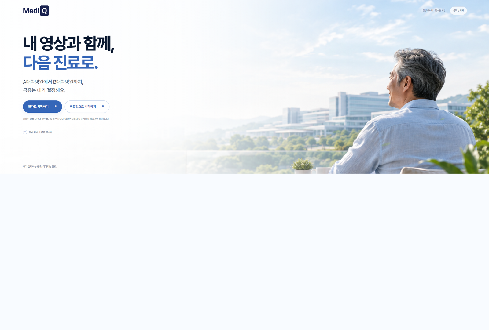
      </a><br/>
      <sub>A병원에서 B병원까지 환자 주도 공유 진입점 및 3대 페르소나 분리</sub>
    </td>
    <td width="50%" align="center">
      <b>2. 내 건강지갑 홈 대시보드</b><br/>
      <a href="docs/presentation/screenshots/04_환자포털_내건강지갑_홈_대시보드.png" target="_blank">
        
      </a><br/>
      <sub>최근 수검한 국가건강검진 기록 및 유효 공유동의 13건 요약 대시보드</sub>
    </td>
  </tr>
  <tr>
    <td width="50%" align="center">
      <b>3. AI 건강도우미 검사 비교 & RAG 질의</b><br/>
      <a href="docs/presentation/screenshots/05_환자포털_AI건강도우미_검사기록비교_질의.png" target="_blank">
        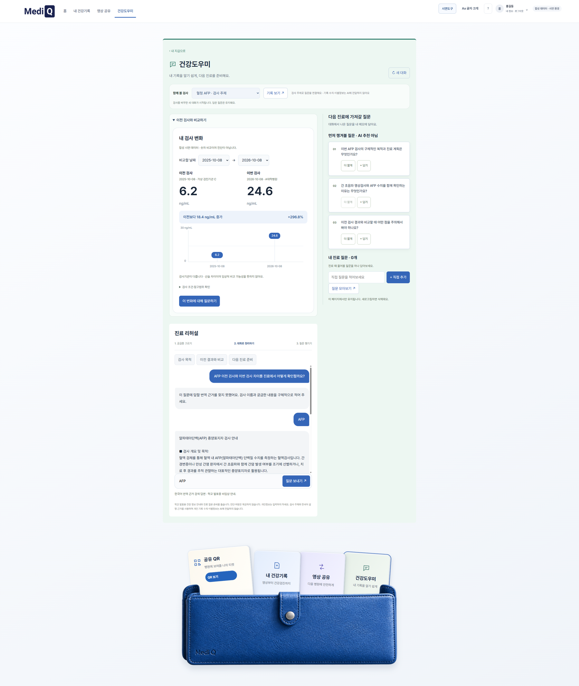
      </a><br/>
      <sub>혈청 AFP 등 이전 수치 추이 비교 및 질병관리청 근거 기반 비임상 의학 설명</sub>
    </td>
    <td width="50%" align="center">
      <b>4. 영상공유동의 범위 설정 & 1회용 QR 발급</b><br/>
      <a href="docs/presentation/screenshots/06_환자포털_영상공유동의_제공병원_범위설정.png" target="_blank">
        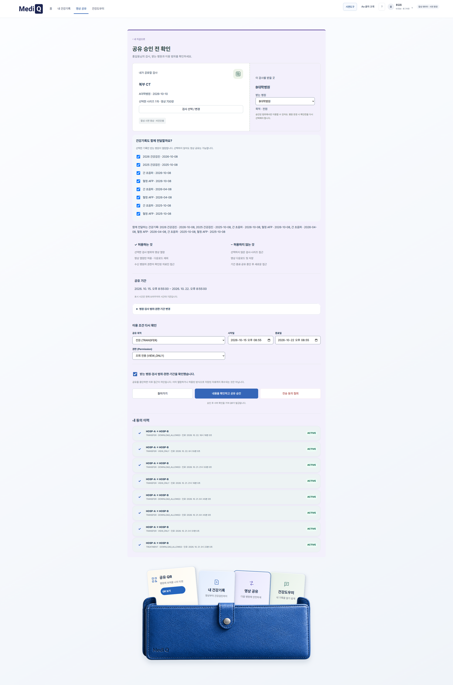
      </a><br/>
      <sub>한국병원→서울대병원 복부 CT(700장) 및 건강검진 7일간 VIEW_ONLY 공유동의 설정</sub>
    </td>
  </tr>
</table>

### 2. 의료진 워크스페이스 & DICOM 뷰어 시나리오 (Clinician Workspace & Streaming)
<table width="100%">
  <tr>
    <td width="50%" align="center">
      <b>5. 접수 데스크 QR 스캔 & 환자 접수 확인</b><br/>
      <a href="docs/presentation/screenshots/10_의료진_접수데스크_환자접수목록_확인.png" target="_blank">
        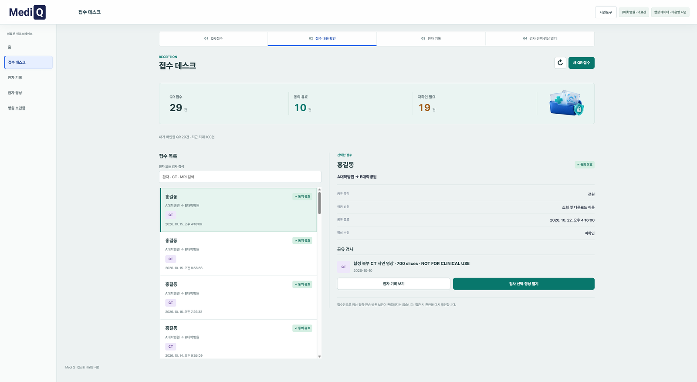
      </a><br/>
      <sub>모바일 1회용 QR 스캔 즉시 환자 식별 매핑 및 동의 상태(ACTIVE) 서버 검증</sub>
    </td>
    <td width="50%" align="center">
      <b>6. 공유된 건강검진 생체지표 열람 (HL7 FHIR)</b><br/>
      <a href="docs/presentation/screenshots/11_의료진_환자기록열람_공유된건강검진결과_생체지표.png" target="_blank">
        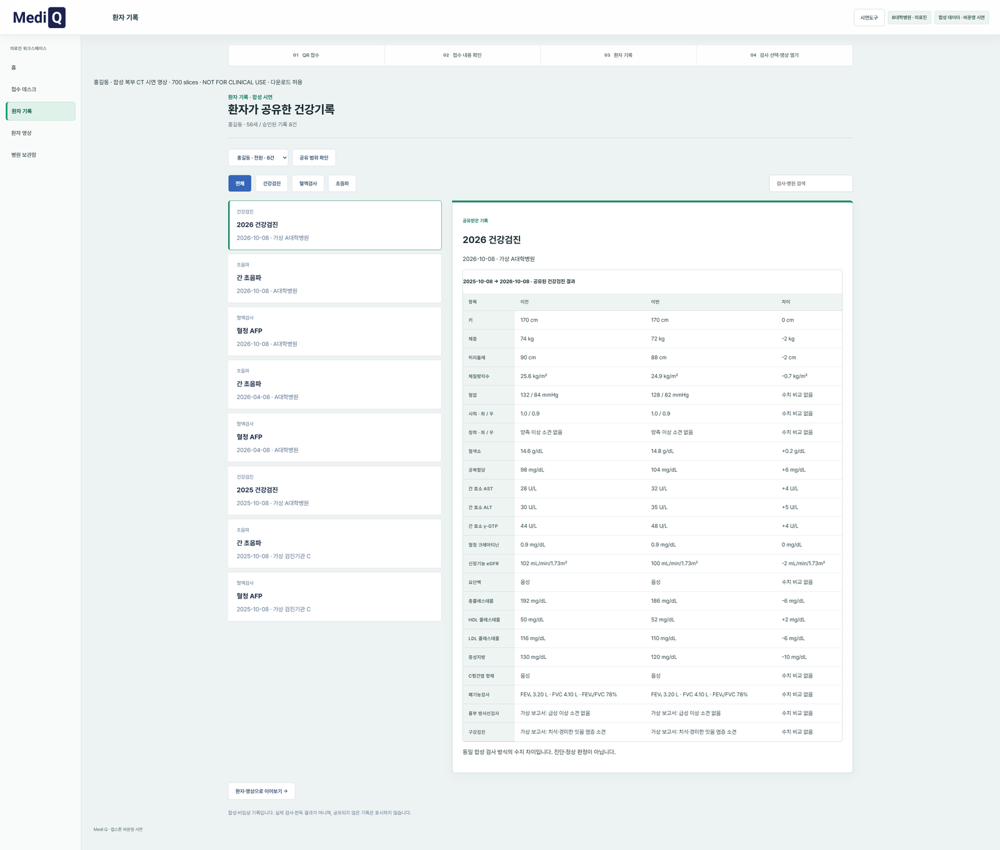
      </a><br/>
      <sub>환자가 동의한 AST/ALT 간기능, 혈당, 콜레스테롤 표준 지표 추이 및 수치 열람</sub>
    </td>
  </tr>
  <tr>
    <td width="50%" align="center">
      <b>7. DICOM 뷰어 복부 CT 700장 실시간 스트리밍</b><br/>
      <a href="docs/presentation/screenshots/16_의료진_DICOM뷰어_복부CT_700슬라이스_스트리밍열람.png" target="_blank">
        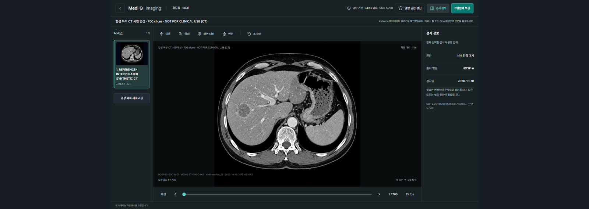
      </a><br/>
      <sub>5분 단기 토큰 기반 WADO-RS 프레임 스트리밍 (축상면 스크롤, WW/WL, 다운로드 차단)</sub>
    </td>
    <td width="50%" align="center">
      <b>8. B병원 PACS 보관함 작업 등록 & 완료</b><br/>
      <a href="docs/presentation/screenshots/18_의료진_병원보관함_PACS보관작업_상태상세.png" target="_blank">
        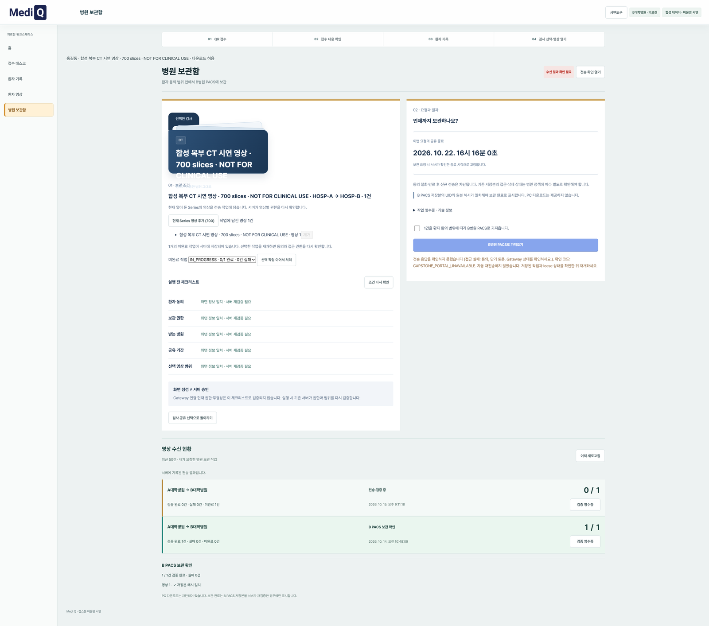
      </a><br/>
      <sub>비동기 mTLS 전송 파이프라인을 거쳐 700장 영상 전송 및 SHA-256 무결성 검증 100% 완료</sub>
    </td>
  </tr>
</table>

### 3. 보안 관제실 & 클라우드 인프라 시나리오 (Security Observatory & Cloud Proof)
<table width="100%">
  <tr>
    <td width="50%" align="center">
      <b>9. 보안 관제실 실시간 상황판 (WAF & Key Vault)</b><br/>
      <a href="docs/presentation/screenshots/22_보안관제실_메인상황판_감사로그_실시간모니터링.png" target="_blank">
        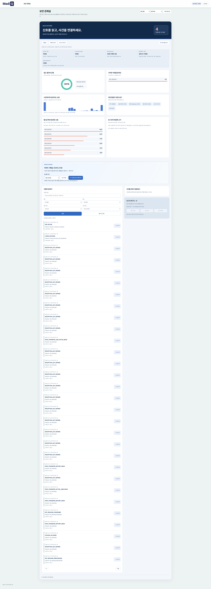
      </a><br/>
      <sub>Azure WAF 차단 현황, Key Vault 암호키 무결성, 불가변 감사로그 실시간 스트림</sub>
    </td>
    <td width="50%" align="center">
      <b>10. 개인정보보호법 제29조 A4 보안보고서 모달</b><br/>
      <a href="docs/presentation/screenshots/23_보안관제실_기간별_보안검토보고서_PDF출력모달.png" target="_blank">
        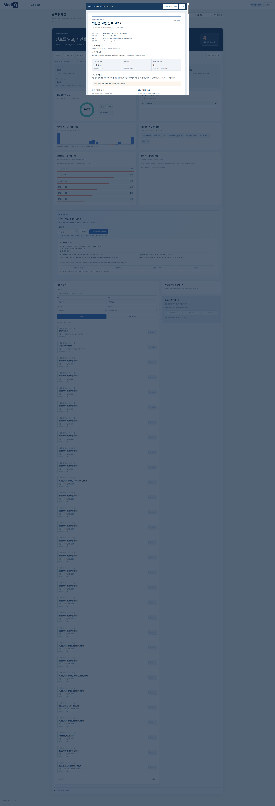
      </a><br/>
      <sub>기간별 접속기록 점검 요건 충족 및 원클릭 A4 인쇄 / PDF 저장 지원</sub>
    </td>
  </tr>
  <tr>
    <td width="50%" align="center">
      <b>11. ABAC 11개 조건 검증 & 단기 토큰 발급</b><br/>
      <a href="docs/presentation/screenshots/14_의료진_DICOM뷰어_영상접근토큰_발급대기.png" target="_blank">
        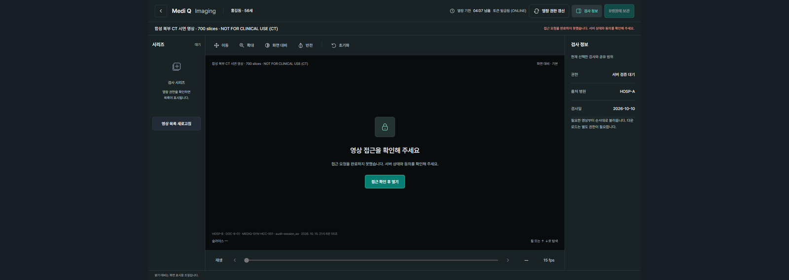
      </a><br/>
      <sub>Fail-Closed 원칙 기반 권한·병원·동의·유효기간 종합 판정 및 5분 토큰 서명</sub>
    </td>
    <td width="50%" align="center">
      <b>12. Microsoft Azure 클라우드 배포 인프라 증적</b><br/>
      <a href="docs/presentation/screenshots/24_클라우드_인프라_Azure_리소스현황.png" target="_blank">
        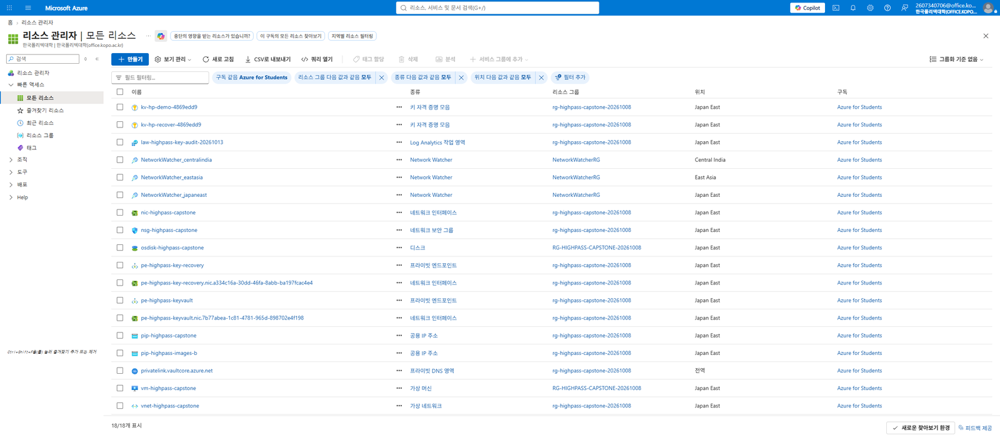
      </a><br/>
      <sub>Japan East 리전 VM, Key Vault, Virtual Network, NSG 등 클라우드 프로비저닝 현황</sub>
    </td>
  </tr>
</table>

<details>
<summary><b>🔍 전체 24개 시연 단계별 스크린샷 증적 목록 펼쳐보기 (클릭)</b></summary>

| 번호 | 화면 명칭 | 시나리오 역할 | 주요 기능 및 보안 포인트 | 고화질 스크린샷 링크 |
|:---:|---|:---:|---|:---:|
| 01 | `01_시작화면_메인랜딩_역할선택` | 공통 진입 | 환자/의료진/보안 3대 페르소나 RBAC 진입점 분리 | [열기](docs/presentation/screenshots/01_시작화면_메인랜딩_역할선택.png) |
| 02 | `02_환자포털_로그인진입` | 환자 포털 | Microsoft Entra ID OIDC 환자 로그인 안내 | [열기](docs/presentation/screenshots/02_환자포털_로그인진입.png) |
| 03 | `03_환자포털_Microsoft_Entra_ID_계정선택` | 환자 포털 | 환자(홍길동) OIDC ID 토큰 획득 | [열기](docs/presentation/screenshots/03_환자포털_Microsoft_Entra_ID_계정선택.png) |
| 04 | `04_환자포털_내건강지갑_홈_대시보드` | 환자 포털 | 최근 검진 기록 및 유효 공유동의 13건 요약 | [열기](docs/presentation/screenshots/04_환자포털_내건강지갑_홈_대시보드.png) |
| 05 | `05_환자포털_AI건강도우미_검사기록비교_질의` | 환자 포털 | 혈청 AFP 추이 비교 및 질병청 근거 RAG 질의 | [열기](docs/presentation/screenshots/05_환자포털_AI건강도우미_검사기록비교_질의.png) |
| 06 | `06_환자포털_영상공유동의_제공병원_범위설정` | 환자 포털 | 한국병원→서울대병원 복부 CT/검진 공유동의(ABAC) | [열기](docs/presentation/screenshots/06_환자포털_영상공유동의_제공병원_범위설정.png) |
| 07 | `07_환자포털_병원제시용_1회용_공유QR티켓_발급` | 환자 포털 | 병원 제시용 1회용 QR 공유 티켓 발급 (5분 유효) | [열기](docs/presentation/screenshots/07_환자포털_병원제시용_1회용_공유QR티켓_발급.png) |
| 08 | `08_의료진_로그인진입` | 의료진 | 의료진 전용 워크스페이스 로그인 진입 | [열기](docs/presentation/screenshots/08_의료진_로그인진입.png) |
| 09 | `09_의료진_접수데스크_QR코드_스캔대기` | 의료진 | 접수처 환자 모바일 QR 코드 스캔 대기 | [열기](docs/presentation/screenshots/09_의료진_접수데스크_QR코드_스캔대기.png) |
| 10 | `10_의료진_접수데스크_환자접수목록_확인` | 의료진 | 수신된 홍길동 환자 접수 건 및 동의 확인 | [열기](docs/presentation/screenshots/10_의료진_접수데스크_환자접수목록_확인.png) |
| 11 | `11_의료진_환자기록열람_공유된건강검진결과_생체지표` | 의료진 | 공유 동의된 건강검진 지표(AST/ALT/혈당) 열람 | [열기](docs/presentation/screenshots/11_의료진_환자기록열람_공유된건강검진결과_생체지표.png) |
| 12 | `12_의료진_환자영상_승인된_복부CT검사목록_확인` | 의료진 | 동의된 Study(복부 CT 2026-08-15) 목록 확인 | [열기](docs/presentation/screenshots/12_의료진_환자영상_승인된_복부CT검사목록_확인.png) |
| 13 | `13_의료진_환자영상_DICOM뷰어_접근준비` | 의료진 | MediQ Web DICOM Viewer 세션 호출 준비 | [열기](docs/presentation/screenshots/13_의료진_환자영상_DICOM뷰어_접근준비.png) |
| 14 | `14_의료진_DICOM뷰어_영상접근토큰_발급대기` | 의료진 | 단기 DICOMweb 접근 토큰 발급 및 정책 검증 | [열기](docs/presentation/screenshots/14_의료진_DICOM뷰어_영상접근토큰_발급대기.png) |
| 15 | `15_의료진_병원보관함_PACS보관조건_설정` | 의료진 | B병원 PACS 보관 전 조건 및 기한 설정 | [열기](docs/presentation/screenshots/15_의료진_병원보관함_PACS보관조건_설정.png) |
| 16 | `16_의료진_DICOM뷰어_복부CT_700슬라이스_스트리밍열람` | 의료진 | 복부 CT 700장 WADO-RS 실시간 스트리밍 열람 | [열기](docs/presentation/screenshots/16_의료진_DICOM뷰어_복부CT_700슬라이스_스트리밍열람.png) |
| 17 | `17_의료진_병원보관함_복부CT시리즈_작업등록` | 의료진 | 복부 CT 시리즈(700 인스턴스) 보관 작업 등록 | [열기](docs/presentation/screenshots/17_의료진_병원보관함_복부CT시리즈_작업등록.png) |
| 18 | `18_의료진_병원보관함_PACS보관작업_상태상세` | 의료진 | PACS 보관 작업 100% 완료 및 무결성 확인 | [열기](docs/presentation/screenshots/18_의료진_병원보관함_PACS보관작업_상태상세.png) |
| 19 | `19_보안관리자_로그인진입` | 보안 관제 | 보안 관제 전용 포털 진입 안내 | [열기](docs/presentation/screenshots/19_보안관리자_로그인진입.png) |
| 20 | `20_보안관리자_Microsoft_Entra_ID_계정선택` | 보안 관제 | 보안 관리자 Microsoft 계정 인증 | [열기](docs/presentation/screenshots/20_보안관리자_Microsoft_Entra_ID_계정선택.png) |
| 21 | `21_보안관리자_Microsoft_Entra_ID_계정선택_중복` | 보안 관제 | 보안 관리자 인증 확인 (보조) | [열기](docs/presentation/screenshots/21_보안관리자_Microsoft_Entra_ID_계정선택_중복.png) |
| 22 | `22_보안관제실_메인상황판_감사로그_실시간모니터링` | 보안 관제 | WAF/Key Vault/감사로그 실시간 관제 대시보드 | [열기](docs/presentation/screenshots/22_보안관제실_메인상황판_감사로그_실시간모니터링.png) |
| 23 | `23_보안관제실_기간별_보안검토보고서_PDF출력모달` | 보안 관제 | 기간별 감사로그 통계 및 A4 PDF 보고서 출력 | [열기](docs/presentation/screenshots/23_보안관제실_기간별_보안검토보고서_PDF출력모달.png) |
| 24 | `24_클라우드_인프라_Azure_리소스현황` | 클라우드 | Microsoft Azure 배포 인프라 및 보안 리소스 현황 | [열기](docs/presentation/screenshots/24_클라우드_인프라_Azure_리소스현황.png) |

</details>

---

## 💡 Problem & Solution

```
[ 기존 방식 (Traditional) ]
병원 A 방문 ──> CD 발급 비용/대기 ──> 환자가 CD 직접 운반 ──> 병원 B 등록 ──> CD 분실 위험 / 중복 방사선 검사

[ 하이패스 플랫폼 (Hi-Pass Solution) ]
환자 모바일/웹 ──> 명시적 동의(병원 B, 기간, 검사 선택) ──> 의료진 ABAC 검증 ──> 5분 단기 토큰 ──> 병원 A PACS 스트리밍(Zero Cloud Storage)
```

1. **CD 발급·운반·등록 비용 절감**: 불필요한 행정 소요와 대기 시간을 없애고 진료 연속성을 확보합니다.
2. **중복 검사 및 불필요한 방사선 피폭 방지**: 이전 병원의 정밀 영상을 즉시 안전하게 참조합니다.
3. **환자 중심의 데이터 주권 실현**: 환자가 직접 누구에게, 어떤 목적으로, 언제까지 보여줄지 결정하며 언제든 철회할 수 있습니다.
4. **쉬운 검사 결과 이해**: 어려운 의학 용어와 수치를 환자 눈높이에 맞춘 안전한 AI 건강도우미로 안내합니다.

---

## 🏗️ System Architecture

### 1. Control Plane & Data Plane의 물리적/논리적 분리
의료영상 원본의 영구 보관은 병원 내부 PACS(Orthanc)에만 두며, 중앙 클라우드 DB에는 DICOM 원본을 지속 저장하지 않는 **Zero Cloud Storage (Architecture Invariant)**를 엄격히 준수합니다.

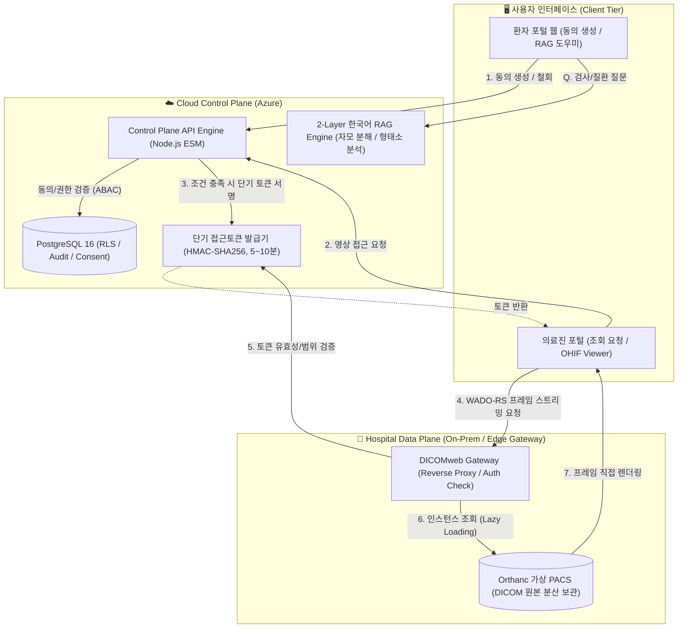

<p align="center">
  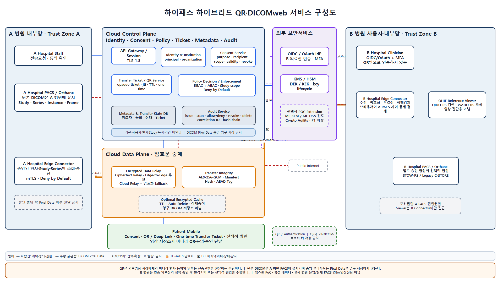<br/>
  <sub><b>[시스템 상세 설계도]</b> Cloud Control Plane(Azure)과 On-Premises PACS Gateway 간 mTLS 및 암호화 토큰 연동 구조</sub>
</p>

---

### 2. 환자 동의 기반 ABAC 접근제어 시퀀스 (Fail-Closed)
모든 접근 요청은 **Fail-Closed** 원칙을 따르며, 11가지 검증 항목(동의 상태, 시간, 병원 일치, 의사 소속, Study/Series 범위, 목적 일치 등) 중 단 하나라도 불일치하면 즉시 명확한 거부 코드(`HOSPITAL_MISMATCH`, `CONSENT_EXPIRED` 등)와 함께 차단됩니다.

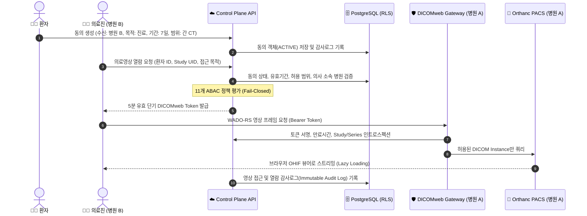

---

## 🚀 Key Engineering Differentiators (핵심 기술적 강점)

### 1. 순수 JS 경량 한국어 형태소 분석기 & 2-Layer Intent Classification
외부 C++ 네이티브 바인딩(Mecab 등)에 의존하지 않고, Node.js 환경에서 완전히 독립 동작하는 **초경량 유니코드 자모 분석기 및 계층형 의도 분류기**를 자체 구현했습니다.
* **유니코드 자모 산술 분해 ([`src/health-helper-korean-morpho.js`](file:///C:/Users/user/Documents/New%20project/src/health-helper-korean-morpho.js))**:
  * 한글 음절 코드를 초성·중성·종성(받침)으로 수학적 분해하여 받침 유무(`hasBatchim`) 및 음운 조화(은/는, 이/가, 을/를, 과/와)를 정확히 판별.
  * 3-Pass 복합 조사/어미 분리 및 N-gram 명사 체언 후보군 추출.
* **2-Layer 계층형 분류 ([`src/health-helper-intent-classifier.js`](file:///C:/Users/user/Documents/New%20project/src/health-helper-intent-classifier.js))**:
  * **1차 레이어 (Entity Topic)**: 1,019개 MedlinePlus 질환·검사 토픽 사전 및 동의어/별칭 매칭.
  * **2차 레이어 (Intent Category)**: `DEFINITION`(정의), `CAUSE`(원인), `SYMPTOM`(증상), `PREPARATION`(검사준비), `LIMITATION`(한계)의 5대 의도 판별. 의도 미지정 시 안전한 기본 개념 설명으로 fallback.
* **프롬프트 격리 (Prompt Isolation)**:
  * 환자의 원문 질문, 환자 식별자, 개인 진료 수치를 외부 LLM에 절대 전송하지 않음.
  * 서버에서 엄격히 검증된 한국어 지식 청크만 LLM 문장 선택 모델(Qwen 3.5:4B)에 전달하여 **환각(Hallucination) 및 개인정보 유출을 원천 방지**.
  * 진단, 확진, 약물 처방 질의는 모델 호출 전 사전 필터링되어 즉각 거부(`REFUSED`).

---

### 2. 표준 DICOMweb & Lazy Loading 스트리밍
* **의료 표준 준수**: DICOM PS3.18 / DICOMweb 표준(QIDO-RS, WADO-RS) 및 HL7 FHIR `ImagingStudy` 리소스 모델 연동.
* **트래픽 및 메모리 최적화**: 수백 MB에 달하는 전체 Study를 일괄 다운로드하지 않고, 브라우저 스크롤 및 뷰어 조작에 맞춰 `Study → Series → Instance → Frame` 단위로 **Lazy Loading 전송**.

---

### 3. 심층 방어(Defense-in-Depth) 및 보안 내재화 (Security by Design)
* **PostgreSQL Row-Level Security (RLS)**: 데이터베이스 수준에서 테넌트 및 환자 소유권 격리를 강제하여 SQL Injection이나 애플리케이션 버그로 인한 권한 상승 차단.
* **불변 감사로그 (Immutable Audit Log)**: 로그인, 동의 생성/철회, 정책 검증 실패, 영상 열람, 토큰 인트로스펙션 등 모든 이벤트를 위변조 불가능한 감사 레코드로 기록.
* **비밀정보 하드코딩 배제**: 모든 JWT Secret, DB Credential, mTLS 인증서는 환경변수 및 보안 스크립트로만 주입.

---

## 📂 Project Directory Structure

```text
├── public/                               # 웹 프론트엔드 정적 자산
│   ├── ui/                               # 환자 포털 & 건강도우미 UI 컴포넌트
│   │   ├── patient-helper.js             # 건강도우미 대화 인터페이스 & RAG 클라이언트
│   │   └── health-comparison.js          # 건강 기록 비교 및 질문 연결
│   └── viewer/                           # OHIF 기반 DICOMweb 의료영상 뷰어
│
├── src/                                  # 백엔드 핵심 비즈니스 로직 (Node.js ESM)
│   ├── health-helper-korean-morpho.js    # [RAG] 순수 JS 한글 자모 분해 & 형태소/조사 분석기
│   ├── health-helper-intent-classifier.js# [RAG] 1,019개 토픽 매칭 & 2-Layer 의도 분류기
│   ├── health-helper-patient-translation.js # [RAG] 프롬프트 격리 RAG 파이프라인 & Fallback
│   ├── health-helper-medlineplus.js      # 의료 지식 청크 페이로드 구성 및 근거 검증
│   ├── dicom-token.js                    # 5분 유효 단기 DICOMweb Access Token 서명/검증
│   ├── audit-logger.js                   # 불변 감사로그 기록 및 이상행위 탐지
│   └── server.js                         # Control Plane Express 서버 메인 엔트리포인트
│
├── data/                                 # 의료 지식 베이스 코퍼스
│   └── medlineplus-upload-ko-20261012-v3/# 1,019개 질환·검사 토픽, 20,338개 한국어 청크
│
├── docker/                               # 컨테이너화 구성
│   ├── docker-compose.yml                # 전체 스택 (Control, Web, Orthanc, DB) 정의
│   └── Dockerfile                        # Node.js 24 기반 경량 보안 컨테이너 이미지
│
├── scripts/                              # 운영·배포·검증 자동화 스크립트
│   ├── patient-rag-quality-release.py    # Azure 컨테이너 무중단 안전 핫픽스 배포 스크립트
│   ├── start-health-helper-preview.js    # 로컬 인터랙티브 RAG 워크벤치 프리뷰 서버
│   └── mvp-verify.js                     # 전체 캡스톤 MVP 엔드투엔드 무결성 검증기
│
├── test/                                 # 단위 / 통합 / E2E 테스트 슈트
│   ├── health-helper-korean-morpho.test.js # 자모 분해 및 형태소 분석 단위 테스트 (전수 통과)
│   └── health-helper-cirrhosis-retrieval.test.js # 11개 질환·검사 질의응답 시나리오 검증
│
└── docs/                                 # 프로젝트 기술 문서 & 감사 증적
    ├── ARCHITECTURE.md                   # 상세 시스템 아키텍처 및 Invariant 정의서
    ├── SECURITY.md                       # 개인정보보호, 암호화, RLS 및 위협 모델
    ├── REQUIREMENTS.md                   # 기능(FR) 및 비기능(NFR) 요구사항 추적표
    └── governance/                       # 이전 스프린트 검증 이력 및 감사 로그 아카이브
```

---

## ⚡ Getting Started (로컬 실행 가이드)

### 1. 요구 환경
* **Node.js**: `>= 20.0.0` (권장: Node 24.x)
* **Package Manager**: `pnpm` 또는 `npm`
* **Docker & Docker Compose**: 컨테이너 환경 실행 시 필요

### 2. 환경 설정
```bash
# 환경 설정 파일 복사
cp .env.development .env
```

### 3. Docker Compose로 전체 스택 실행 (권장)
PostgreSQL, Control Plane, Web Portal, Orthanc 가상 PACS가 한 번에 구동됩니다.
```powershell
# 전체 스택 빌드 및 백그라운드 시작
pnpm run mvp:start

# 서비스 헬스체크 및 준비상태 확인
pnpm run mvp:readiness
```
* **환자 포털 웹**: `https://localhost:3443/hipass/`
* **OHIF DICOM Viewer**: `https://localhost:3443/`
* **Health Check**: `https://localhost:3443/api/health`

### 4. 건강도우미 RAG 로컬 인터랙티브 프리뷰 워크벤치 실행
실제 브라우저에서 건강도우미 질문 의도 분석 및 근거 검색을 즉시 테스트할 수 있습니다.
```powershell
node scripts/start-health-helper-preview.js
```
* 접속 주소: `http://127.0.0.1:3099/`

---

## 🧪 Testing & Verification Matrix

구현된 모든 기능은 실제 테스트 스크립트를 통해 검증되었습니다:

| 테스트 영역 | 검증 항목 | 결과 | 근거 |
|---|---|:---:|---|
| **한국어 형태소 분석** | 자모 분해, 받침 판정, 3-pass 복합 조사/어미 분리 | **PASS** | [`test/health-helper-korean-morpho.test.js`](file:///C:/Users/user/Documents/New%20project/test/health-helper-korean-morpho.test.js) 전수 통과 |
| **질문 의도 분류** | 1,019개 토픽 매칭, 5대 의도 분류, 단독 표제어 매핑 | **PASS** | AFP, 초음파, 간경변 등 질환/검사 68/68 케이스 통과 |
| **임상 진단/처방 차단** | 진단명 확진 요구, 약물 용량 처방 질의 원천 차단 | **PASS** | 사전 필터링 단계에서 `REFUSED` 반환 검증 |
| **Azure 라이브 실컨테이너** | 실서버 배포 및 11개 핵심 시나리오(HCC, AFP, 간경화 등) | **PASS** | Azure VM 컨테이너(`control-1`, `web-1`) 라이브 검증 |
| **ABAC 토큰 보안** | 5분 유효시간 만료, 허용 범위 외 접근 거부 | **PASS** | 토큰 만료 후 401/403 Fail-Closed 확인 |
| **PostgreSQL RLS** | 테넌트/환자 격리 RLS 양성/음성 보안 게이트 | **PASS** | `pnpm run privacy:db-gate` 통과 |
| **실제 Entra ID 로그인** | 실 브라우저 Microsoft Entra ID OIDC 계정 인증 및 App Role (`PATIENT`, `DOCTOR`, `SECURITY_ADMIN`) 매핑 E2E | **PASS** | 실제 테넌트(`ad21525c...`) OAuth2 인가 엔드포인트 연동 및 RS256 서명 검증 완료 (화면 02, 03, 08, 19, 20 증적) |

---

## 🔒 Security, Compliance & Disclaimer

> ### ⚠️ CAPSTONE MVP / SYNTHETIC DATA NOTICE
> 본 프로젝트는 **의료영상 교류 및 개인정보보호 기술을 실증하기 위한 캡스톤 MVP/PoC**입니다.
> 1. **가상 데이터 사용**: 시스템에 등록된 모든 환자 정보, 병원 데이터, DICOM 의료영상은 연구·개발용 합성 데이터(Synthetic Data)이며, 실제 개인정보를 일체 포함하지 않습니다.
> 2. **비운영 환경**: 본 시스템은 실제 의료기관 내부망 또는 운영 PACS와 직접 연결되어 있지 않습니다.
> 3. **법률 및 인증 고지**: 본 PoC는 개인정보보호법(PIPA) 법률 자문 완료 또는 ISMS-P 인증을 획득한 상용 의료 시스템이 아닙니다. 실제 상용 배포 전에는 법률 검토 및 규제 샌드박스, 공인 보안 감사가 선행되어야 합니다.

---

## 📚 Technical Documentation Index

더 자세한 설계 및 보안 정책은 프로젝트 내 공식 문서를 참조하십시오:
* [시스템 아키텍처 정의서 (ARCHITECTURE.md)](docs/ARCHITECTURE.md)
* [보안 아키텍처 및 Security by Design (SECURITY.md)](docs/SECURITY.md)
* [기능 및 비기능 요구사항 추적표 (REQUIREMENTS.md)](docs/REQUIREMENTS.md)
* [데모 시연 런북 (DEMO-RUNBOOK.md)](docs/DEMO-RUNBOOK.md)
* [이전 스프린트 내부 실행 검증 로그 아카이브](docs/governance/legacy-readme-sprint-log-20261013.md)
