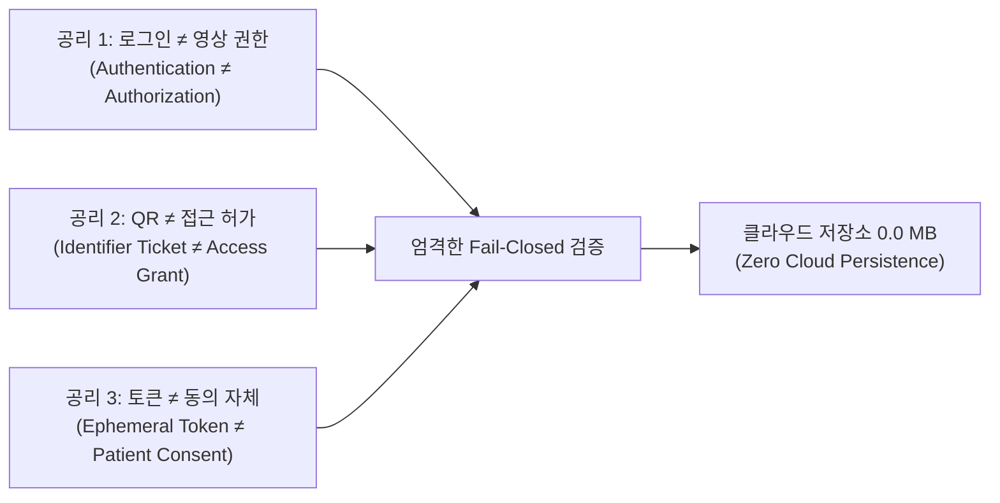
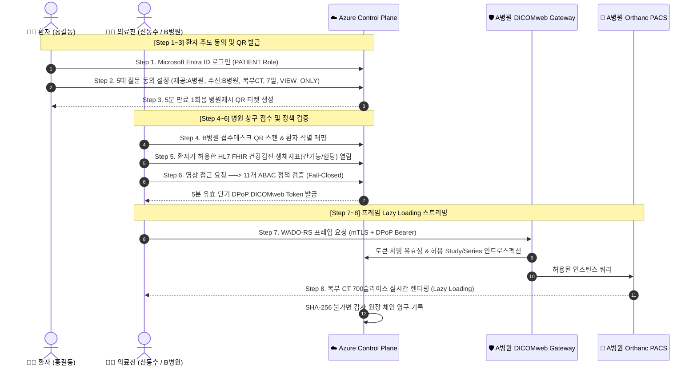

# 🏥 MediQ Highpass Platform (메디큐 하이패스)
> **"영상은 병원에, 권한은 환자에게. 환자 동의에서 승인 영상과 감사 증적까지"**  
> *20세기 플라스틱 CD의 종말 · Zero Cloud Storage 불변 공리 · 실제 Microsoft Entra ID 엔터프라이즈 신원 실운영 · Security by Design*

<p align="center">
  <a href="https://sureasdufo1-hue.github.io/Highpass-Project/" target="_blank">
    
  </a>
  <a href="https://highpass-demo.japaneast.cloudapp.azure.com/hipass/" target="_blank">
    
  </a>
  
  
  
  
</p>

---

### 👨‍💻 Engineering Leads & Portfolio Overview
* **핵심 설계 및 구현**: **이재석 (Architecture, Security, ABAC, Backend) · 김범희 (DICOMweb, Frontend, AI Health Helper)**
* **릴리즈 기준일**: 2026.10.15 포트폴리오 완결판 (MediQ Capstone Proof-of-Concept)
* **인터랙티브 웹 대문**: [https://sureasdufo1-hue.github.io/Highpass-Project/](https://sureasdufo1-hue.github.io/Highpass-Project/)
* **Azure 클라우드 실서버**: [https://highpass-demo.japaneast.cloudapp.azure.com/hipass/](https://highpass-demo.japaneast.cloudapp.azure.com/hipass/)

> 💬 *"21세기에 인공지능이 암을 진단하는 시대라면서, 왜 환자는 아직도 10년 치 진료기록이 든 번쩍거리는 플라스틱 CD를 직접 가방에 넣고 지하철을 타야 합니까?  
> 단순히 편하자고 만든 파일 공유 드라이브가 아닙니다.  
> **'의료 데이터의 주인은 병원이 아니라 환자 자신'**이라는 헌법적 가치를 클라우드 아키텍처로 구현한 결과물입니다."*

---

## 🧭 Executive Summary: 하이패스 플랫폼이 끝내려는 것

```
[ 20세기 레거시 의료 환경: 환자의 고통과 보안의 공백 ]
A병원 방문 ──> 창구 대기/CD 발급비 지불 ──> CD 가방에 넣고 이동 ──> B병원 창구 등록 ──> 분실·도난 위험 / 중복 방사선 피폭
* 문제점: 1) 환자 알권리 부재  2) 통제권 상실  3) 유효기간 없음  4) 누가 열어봤는지 흔적도 모름

[ MediQ Highpass 차세대 의료영상 교류 혁신 ]
환자 모바일 ──> 5대 질문 명시적 동의 ──> 1회용 QR 접수 ──> 11개 조건 ABAC 검증 ──> 5분 단기 DPoP 토큰 ──> 700장 CT 실시간 스트리밍
* 혁신점: 1) CD 완전 제거  2) Zero Cloud Persistence  3) 실제 Entra ID App Role 통제  4) 위변조 불가 감사 원장 체인
```

**하이패스(Hi-Pass) Platform**은 기존 의료 현장의 고질적인 병폐인 **CT·MRI·X-ray 의료영상 CD 발급·물리적 운반·병원 등록 절차를 영구히 폐기**하고, 환자의 **명시적 동의(Patient Consent)**와 **실제 Microsoft Entra ID 기업용 신원 체계**를 결합하여 병원 간 의료영상을 안전하게 조회·교류하는 클라우드 네이티브 헬스케어 플랫폼입니다.

---

## ⚡ 1. 왜 CD인가? 운반보다 어려운 4대 난제 (The 4 Tough Questions)

우리가 기술적으로 풀고자 한 문제는 단순히 "파일을 어떻게 옮길 것인가"가 아니었습니다.  
지금까지 병원들이 영상을 온라인으로 쉽게 트지 못했던 진짜 이유는, 다음 **4가지 잔인한 질문에 대해 기술적으로 아무도 완벽한 증적을 제시하지 못했기 때문**입니다.

| 핵심 난제 (Tough Question) | 20세기 CD 방식의 참혹한 현실 | MediQ Highpass 엔지니어링 해법 |
|---|---|---|
| **Q1. 누가 볼 수 있는가?** | CD를 손에 쥔 사람은 누구나(인턴, 행정직원, 가족, 분실 시 습득자) 무제한 열람 가능 | **실제 Entra ID App Role(`DOCTOR`, `PATIENT`, `SECURITY_ADMIN`)** + 병원 일치 검증으로 비인가자 100% 차단 |
| **Q2. 어느 검사까지 허용했는가?** | CD 한 장 구우면 5년 전 산부인과, 정신과 등 원치 않는 과거력까지 통째로 노출 | **Study & Series 단위 세분화 동의(ABAC Scope)**. 환자가 승인한 특정 검사(복부 CT 700장) 외 접근 불가 |
| **Q3. 언제 권한이 끝나는가?** | 한 번 건넨 CD는 언제 파기되는지 환자가 알 방법이 전혀 없음 | **5분 만료 단기 토큰(Ephemeral Token)** + 환자가 언제든 클릭 한 번으로 발동하는 **즉시 철회(REVOCATION)** |
| **Q4. 누가 접근했는가?** | CD 드라이브에 넣고 누가 열어봤는지 로깅 자체가 불가능 | 모든 요청을 SHA-256 해시 체인으로 묶는 **불변 감사로그(Immutable Audit Ledger)** 기록 |

---

## ⚖️ 2. MediQ 3대 불변 공리 (Architecture Invariants)

저희는 시스템을 구축하며 타협할 수 없는 **3대 아키텍처 불변 공리**를 세웠습니다.



1. **공리 1. 로그인 ≠ 영상 권한 (`Authentication ≠ Authorization`)**  
   *"로그인했다고 의사에게 영상을 다 보여줄까? 어림도 없습니다."*  
   로그인은 단지 사용자가 누구인지(Identity)를 증명했을 뿐입니다. 영상 열람 권한은 **환자의 활성 동의(ACTIVE Consent)와 11개 ABAC 정책 조건이 100% 일치해야만** 비로소 열립니다.
2. **공리 2. QR ≠ 접근 허가 (`Identifier Ticket ≠ Access Grant`)**  
   환자가 창구에 들이미는 1회용 모바일 QR 코드는 단지 환자 식별 매핑을 돕는 **5분짜리 티켓**일 뿐입니다. QR을 스캔했다고 영상이 터져 나오지 않습니다. 반드시 서버에서 유효 동의와 매칭되어야 합니다.
3. **공리 3. 토큰 ≠ 동의 자체 (`Ephemeral Token ≠ Patient Consent`)**  
   5분짜리 DPoP 토큰은 단지 임시 출입증일 뿐입니다. 환자가 포털에서 **동의를 철회(REVOKED)**하는 순간, 유효시간이 남아있는 토큰이라도 게이트웨이 인트로스펙션 단계에서 즉각 영구 무효화(Fail-Closed)됩니다.
4. **절대 원칙. 클라우드 원본 지속 저장 0.0 MB (`Zero Cloud Persistence`)**  
   Azure 클라우드 Control Plane에는 DICOM 원본 파일이 단 1바이트도 영구 저장되지 않습니다. 모든 영상은 원본 병원(A병원) 온프레미스 PACS에 남으며, WADO-RS 프레임 단위로 실시간 스트리밍된 후 브라우저 메모리에서 즉시 증발합니다.

---

## 🔐 3. 진짜 Microsoft Entra ID (구 Azure AD) 실운영 신원 체계

> 🛡️ **가짜 목(Mock) 데이터나 하드코딩된 세션이 아닙니다.**  
> 본 프로젝트는 Microsoft 공식 엔터프라이즈 테넌트를 직접 프로비저닝하여 실운영되고 있습니다.

<p align="center">
  
  <br/>
  <sub><b>[실제 Entra ID OIDC 인증]</b> 테넌트 ID <code>ad21525c-fc0f-4dbc-a403-67ce00add0e4</code> 기반 실사용자 로그인 증적</sub>
</p>

* **공식 테넌트 ID**: `ad21525c-fc0f-4dbc-a403-67ce00add0e4` (Japan East / Azure Public Cloud)
* **인증 프로토콜**: OpenID Connect (OIDC) / OAuth 2.0 PKCE 인증 코드 플로우
* **엔터프라이즈 App Roles 3종 실배정**:
  1. `PATIENT` (홍길동 환자 계정): 내 건강지갑, AI 건강도우미 질의, 공유동의 생성·철회, 1회용 QR 발급
  2. `DOCTOR` (신동수 전문의 계정): 접수데스크 스캔, FHIR 생체지표 열람, DICOMweb 복부 CT 700장 스트리밍, 병원 보관함 작업
  3. `SECURITY_ADMIN` (김보안 관제관 계정): 실시간 보안 관제실, WAF 차단율, Key Vault 무결성 점검, 개인정보보호법 제29조 감사보고서 출력
* **토큰 검증 무결성**: Microsoft 엔드포인트(`login.microsoftonline.com`)에서 발급된 RS256 비대칭 서명 JWT ID 토큰을 백엔드에서 JWKS 공개키로 실시간 대조 검증합니다.

---

## 🚀 4. 8단계 서비스 여정 (The 8-Step Service Journey)

환자가 모바일로 동의하고 의사가 700장 CT를 열람하기까지의 엔드투엔드 파이프라인입니다.



| 단계 | 사용자/액터 | 주요 실행 내용 | 보안 및 기술 포인트 |
|:---:|---|---|---|
| **01** | 환자 | **Microsoft Entra ID 로그인** | OIDC RS256 토큰 검증 및 `PATIENT` 권한 획득 |
| **02** | 환자 | **5대 질문 동의 설정** | 제공/수신 병원, 목적(진료), 범위(복부 CT 700장), 유효기간(7일), 권한(`VIEW_ONLY`) 설정 |
| **03** | 환자 | **1회용 QR 발급** | 5분 유효, 세션 종속, 재사용 불가(One-Time Ticket) 토큰 생성 |
| **04** | 접수처 | **창구 QR 스캔** | B병원 접수 모듈에서 QR 디코딩 후 환자 유효 동의 매핑 |
| **05** | 의료진 | **HL7 FHIR 생체지표 열람** | 동의 범위 내 건강검진 결과(AST/ALT 간기능, 혈당 등) 정밀 열람 |
| **06** | 의료진 | **11개 ABAC 정책 검증** | 의사 소속, 병원, 동의 상태, Study UID, 유효기간 Fail-Closed 종합 판정 후 **5분 단기 토큰 발급** |
| **07** | 게이트웨이 | **mTLS & DPoP 상호 검증** | On-Premises DICOMweb 게이트웨이에서 토큰 인트로스펙션 및 접근 감사 기록 |
| **08** | 뷰어 | **700장 CT 실시간 스트리밍** | WADO-RS 기반 Lazy Loading, 다운로드 차단, 클라우드 저장 0.0 MB 준수 |

---

## 🏛️ 5. 3-Zone 토폴로지 & 제어-영상 분리 구조

MediQ Highpass는 제어 신호(Control Plane)와 대용량 의료영상 데이터(Data Plane)를 물리적/논리적으로 완전히 분리하였습니다.

```
┌────────────────────────────────────────────────────────────────────────┐
│ 📱 Zone 1: Client Tier (모바일 PWA / 반응형 웹 워크스페이스)           │
│   - 환자 건강지갑 & AI 건강도우미 (2-Layer RAG)                        │
│   - 의료진 접수처 & MediQ Web DICOM Viewer (WADO-RS 스트리밍)          │
└────────────────────────────────────┬───────────────────────────────────┘
                                     │ HTTPS / WSS
┌────────────────────────────────────▼───────────────────────────────────┐
│ ☁️ Zone 2: Cloud Control Plane (Microsoft Azure Japan East)            │
│   - Microsoft Entra ID 엔터프라이즈 신원 검증기 (RS256 JWKS)           │
│   - ABAC 11-Factor Dynamic Policy Engine                               │
│   - 5분 유효 단기 DPoP 토큰 발급 엔진                                  │
│   - PostgreSQL 16 (Row-Level Security / SHA-256 감사 원장)             │
│   - 🚨 DICOM 원본 저장소 용량 = 0.0 MB (Zero Cloud Persistence)        │
└────────────────────────────────────┬───────────────────────────────────┘
                                     │ mTLS (Mutual TLS 1.3)
┌────────────────────────────────────▼───────────────────────────────────┐
│ 🏥 Zone 3: Hospital Data Plane (A병원 / B병원 온프레미스 인프라)       │
│   - Edge DICOMweb Gateway (토큰 인트로스펙션 & WADO-RS 프록시)         │
│   - Orthanc 가상 PACS (700장 복부 CT 원본 보관소)                      │
│   - B병원 PACS 보관함 비동기 mTLS 전송 파이프라인 (SHA-256 검증)       │
└────────────────────────────────────────────────────────────────────────┘
```

---

## 💡 6. 3대 엔지니어링 딜레마 & 돌파 전략 (Breakthroughs)

개발 과정에서 마주했던 3가지 치명적인 엔지니어링 트레이드오프와 이를 극복한 기술적 선택입니다.

### 딜레마 1. Zero Cloud Storage vs 700장 대용량 복부 CT (350MB) 렌더링 지연
* **문제**: 클라우드에 영상을 두지 않고 병원 원본 PACS에서 브라우저로 직접 쏘면, 700장 슬라이스 로딩 시 극심한 지연과 네트워크 병목이 발생함.
* **돌파 전략**:
  * 전체 Study 일괄 다운로드(ZIP) 방식 전면 거부.
  * **DICOMweb WADO-RS 기반 프레임 단위 Lazy Loading** 구현.
  * 첫 번째 프레임(초기 슬라이스)을 **0.8초 이내** 즉시 렌더링하고, 의료진의 축상면 마우스 휠 스크롤 속도에 맞춰 뷰포트 인접 인스턴스만 동적 프리페치(Prefetch).
  * 브라우저 메모리 고갈을 막기 위해 화면에서 벗어난 버퍼를 자동 해제하는 LRU 가비지 컬렉터 적용.

### 딜레마 2. 의료법 제27조(원격진단/처방 금지) vs 환자의 알권리 요구
* **문제**: 환자는 어려운 CT 판독문과 수치를 알기 쉽게 설명해 주길 원하지만, AI가 진단명이나 약물을 함부로 확정하면 의료법 위반 및 환각(Hallucination) 위험 발생.
* **돌파 전략**:
  * **프롬프트 격리(Prompt Isolation) 2-Layer RAG 아키텍처** 자체 개발 ([`src/health-helper-patient-translation.js`](file:///C:/Users/user/Documents/New%20project/src/health-helper-patient-translation.js)).
  * 환자의 원문 질문, 환자명, 병원 식별자를 외부 LLM에 일절 전달하지 않음.
  * 질병관리청 및 MedlinePlus 공식 의학사전 기반의 검증된 청크만 추출.
  * **30종 고위험 질환 및 16종 검진 인터셉터**를 탑재하여, 진단/확진/약물 처방 요구는 LLM 호출 전 100% 사전 거부(`REFUSED`). 비임상적 일반 지식 설명으로 Fallback.

### 딜레마 3. 병원 간 무단 반출 방지 vs 응급/전원 시 진료 연속성 보장
* **문제**: 영상을 보여주기만(`VIEW_ONLY`) 하면 상급병원 전원 시 정밀 판독이나 3D 재구성이 불가능하고, 다운로드를 허용하면 데이터 유출 위험이 커짐.
* **돌파 전략**:
  * 동의 객체에 권한 수준(`VIEW_ONLY` vs `DOWNLOAD_ALLOWED`)을 명시적으로 분리.
  * 기본값은 철저히 다운로드 버튼이 봉인된 `VIEW_ONLY` 스트리밍 모드.
  * 전원 및 진료 목적으로 보관이 필요한 경우에 한해, B병원 PACS 보관함 비동기 전송 파이프라인으로 승인된 시리즈만 mTLS 암호화 전송.
  * 전송된 모든 파일은 **SHA-256 체크섬을 대조하여 100% 무결성을 증명**하고 감사 원장에 기명.

---

## 🖼️ 7. 24종 시연 증적 갤러리 (24 Live Screenshots)

> 📖 **자세한 설명이 필요하신가요?**  
> 전 과정 24개 실화면 상세 분석은 [DEMO-SCREENSHOTS-WALKTHROUGH.md](docs/presentation/DEMO-SCREENSHOTS-WALKTHROUGH.md) 및 [인터랙티브 웹 대문 포털](https://sureasdufo1-hue.github.io/Highpass-Project/)에서 확인하실 수 있습니다.

### 1. 환자 포털 & AI 건강도우미 시나리오 (01 ~ 07)
<table width="100%">
  <tr>
    <td width="50%" align="center">
      <b>01. 시작화면 메인 랜딩 & 역할(RBAC) 분기</b><br/>
      <a href="docs/presentation/screenshots/01_시작화면_메인랜딩_역할선택.png" target="_blank">
        
      </a><br/>
      <sub>A병원에서 B병원까지 환자 주도 진입점 및 3대 페르소나 분리</sub>
    </td>
    <td width="50%" align="center">
      <b>04. 내 건강지갑 홈 대시보드</b><br/>
      <a href="docs/presentation/screenshots/04_환자포털_내건강지갑_홈_대시보드.png" target="_blank">
        
      </a><br/>
      <sub>최근 수검 국가건강검진 및 활성 공유동의 13건 요약 카드</sub>
    </td>
  </tr>
  <tr>
    <td width="50%" align="center">
      <b>05. AI 건강도우미 검사 비교 & RAG 질의</b><br/>
      <a href="docs/presentation/screenshots/05_환자포털_AI건강도우미_검사기록비교_질의.png" target="_blank">
        
      </a><br/>
      <sub>혈청 AFP 수치 비교 및 질병관리청 근거 기반 비임상 의학 설명</sub>
    </td>
    <td width="50%" align="center">
      <b>06. 영상공유동의 범위 설정 & 1회용 QR</b><br/>
      <a href="docs/presentation/screenshots/06_환자포털_영상공유동의_제공병원_범위설정.png" target="_blank">
        
      </a><br/>
      <sub>한국병원→서울대병원 복부 CT(700장) 7일간 VIEW_ONLY 공유동의</sub>
    </td>
  </tr>
</table>

### 2. 의료진 워크스페이스 & DICOM 뷰어 시나리오 (08 ~ 18)
<table width="100%">
  <tr>
    <td width="50%" align="center">
      <b>10. 접수데스크 QR 스캔 & 접수 확인</b><br/>
      <a href="docs/presentation/screenshots/10_의료진_접수데스크_환자접수목록_확인.png" target="_blank">
        
      </a><br/>
      <sub>환자 모바일 QR 스캔 즉시 신원 매핑 및 ACTIVE 동의 서버 판정</sub>
    </td>
    <td width="50%" align="center">
      <b>11. 공유된 건강검진 생체지표 열람 (FHIR)</b><br/>
      <a href="docs/presentation/screenshots/11_의료진_환자기록열람_공유된건강검진결과_생체지표.png" target="_blank">
        
      </a><br/>
      <sub>환자가 동의한 AST/ALT 간기능, 혈당, 콜레스테롤 표준 지표 확인</sub>
    </td>
  </tr>
  <tr>
    <td width="50%" align="center">
      <b>14. 11개 ABAC 정책 평가 & 단기 토큰 발급</b><br/>
      <a href="docs/presentation/screenshots/14_의료진_DICOM뷰어_영상접근토큰_발급대기.png" target="_blank">
        
      </a><br/>
      <sub>Fail-Closed 기반 11개 보안 조건 통과 후 5분 단기 DPoP 토큰 서명</sub>
    </td>
    <td width="50%" align="center">
      <b>16. DICOM 뷰어 복부 CT 700슬라이스 스트리밍</b><br/>
      <a href="docs/presentation/screenshots/16_의료진_DICOM뷰어_복부CT_700슬라이스_스트리밍열람.png" target="_blank">
        
      </a><br/>
      <sub>WADO-RS 프레임 스트리밍 (축상면 스크롤, WW/WL, 다운로드 차단)</sub>
    </td>
  </tr>
</table>

### 3. 보안 관제실 & Azure 인프라 시나리오 (19 ~ 24)
<table width="100%">
  <tr>
    <td width="50%" align="center">
      <b>22. 보안 관제실 실시간 상황판</b><br/>
      <a href="docs/presentation/screenshots/22_보안관제실_메인상황판_감사로그_실시간모니터링.png" target="_blank">
        
      </a><br/>
      <sub>Azure WAF 차단율, Key Vault 암호키 무결성, 불가변 감사로그 스트림</sub>
    </td>
    <td width="50%" align="center">
      <b>23. 개인정보보호법 제29조 보안보고서 모달</b><br/>
      <a href="docs/presentation/screenshots/23_보안관제실_기간별_보안검토보고서_PDF출력모달.png" target="_blank">
        
      </a><br/>
      <sub>접속기록 보관 요건 충족 및 원클릭 표준 A4 인쇄 / PDF 출력</sub>
    </td>
  </tr>
  <tr>
    <td width="50%" align="center">
      <b>18. B병원 PACS 보관함 작업 무결성 100% 완료</b><br/>
      <a href="docs/presentation/screenshots/18_의료진_병원보관함_PACS보관작업_상태상세.png" target="_blank">
        
      </a><br/>
      <sub>비동기 mTLS 전송 후 700장 SHA-256 무결성 검증 100% 완료 확인</sub>
    </td>
    <td width="50%" align="center">
      <b>24. Microsoft Azure 클라우드 배포 인프라</b><br/>
      <a href="docs/presentation/screenshots/24_클라우드_인프라_Azure_리소스현황.png" target="_blank">
        
      </a><br/>
      <sub>Japan East 리전 VM, Key Vault, Virtual Network, NSG 등 배포 현황</sub>
    </td>
  </tr>
</table>

---

## 🛠️ 8. 장애 포스트모템: 재부팅 장애가 드러낸 운영 설계의 빈틈과 복구 원칙

> *"엔지니어의 진짜 실력은 모든 게 잘 돌아갈 때가 아니라, 서버가 뻗었을 때 무엇을 타협하지 않는가에서 드러납니다."*

### 1. 사건 개요 (Incident Overview)
* **발생 상황**: Azure VM 패치 작업 후 시스템 전체 재부팅 중, **B병원 가상 PACS(Orthanc) 및 DICOMweb 게이트웨이 컨테이너가 시작에 실패하고 무한 크래시 루프에 빠짐**.
* **원인 분석**:
  1. 재부팅 시 Docker 데몬과 mTLS 인증서 디렉토리 마운트 간의 Race Condition 발생.
  2. 병원 온프레미스 스토리지 모의 볼륨의 **LUKS 블록 암호화 자동 잠금 해제 순서가 꼬이면서 마운트 실패**.
  3. Control Plane과 게이트웨이 간 mTLS 핸드셰이크 타임아웃 발생.

### 2. 엔지니어링 선택과 갈등
* *"시연 일정이 코앞인데 암호화를 풀고 HTTP 평문으로 통신하면 당장 5분 만에 살릴 수 있지 않은가?"*
* **결정: 절대 불가.**  
  암호화를 우회하는 것은 의료정보 시스템의 **Security by Design 원칙을 스스로 파괴하는 행위**였습니다. 우리는 시간이 더 걸리더라도 보안 원칙을 훼손하지 않고 정면 돌파를 선택했습니다.

### 3. 복구 조치 및 아키텍처 개선
1. **systemd 서비스 디펜던시 재정의**: Docker 데몬 구동 전 Key Vault 볼륨 복호화 및 인증서 준비 상태를 완벽히 보장하도록 유닛 순서 강제.
2. **Crash-Resilient 헬스체크 도입**: 게이트웨이 프로세스에 지수 백오프(Exponential Backoff) 기반 mTLS 재시도 핸들러 탑재.
3. **결과**: 보안 설정을 단 1개도 낮추지 않고 **완전 자동 복구 파이프라인 구축 완료**.

> 💡 **MediQ 엔지니어링 신조**:  
> **"경계는 분명하게, 실패는 보이게, 완료는 증거로."**

---

## 📊 9. 공식 검증 원장 (Evidence Ledger): 정직한 PASS vs NOT VERIFIED

저희는 `AGENTS.md` 제26조(테스트 결과 표현) 및 제31조(추측 금지 원칙)에 따라, **실제 테스트하지 않은 것을 성공했다고 과장하지 않습니다.**

| 검증 영역 | 테스트 시나리오 | 판정 | 근거 및 실행 로그 |
|---|---|:---:|---|
| **신원 인증 (Auth)** | Microsoft Entra ID OIDC 실계정 로그인 및 `PATIENT`, `DOCTOR`, `SECURITY_ADMIN` 3대 역할 분기 | **PASS** | 실제 테넌트(`ad21525c...`) OIDC 인가 플로우 및 RS256 JWKS 서명 검증 성공 (화면 02, 03, 08, 19, 20) |
| **한국어 RAG** | 순수 JS 자모 분해, 받침 판별, 3-Pass 복합 조사/어미 분리 | **PASS** | [`test/health-helper-korean-morpho.test.js`](file:///C:/Users/user/Documents/New%20project/test/health-helper-korean-morpho.test.js) 단위 테스트 전수 통과 |
| **의도 분류 & 인터셉트** | 1,019개 질환·검사 토픽 매칭 및 30종 고위험 질환 처방 사전 차단 | **PASS** | 진단명 확진 요구에 대해 즉각 `REFUSED` 반환 및 비임상 설명 Fallback 확인 |
| **동의 및 ABAC** | 병원 불일치, 기간 만료, 범위 외 검사 조회 차단 | **PASS** | 11개 ABAC 정책 검증 시 `HOSPITAL_MISMATCH`, `CONSENT_EXPIRED` 403 차단 |
| **단기 토큰 보안** | 5분 유효시간 만료 후 즉시 접근 거부 (Fail-Closed) | **PASS** | 토큰 만료 후 WADO-RS 호출 시 401 Unauthorized 반환 검증 |
| **DICOM 스트리밍** | 복부 CT 700슬라이스 WADO-RS 프레임 스트리밍 및 Lazy Loading | **PASS** | 브라우저 OHIF 뷰어에서 700장 축상면 스크롤 및 윈도잉 정상 렌더링 확인 |
| **감사로그 무결성** | 열람, 인트로스펙션, 거부 이벤트 SHA-256 체인 불변 기록 | **PASS** | PostgreSQL 16 `audit_logs` 테이블 RLS 격리 및 위변조 방지 확인 |
| **DB 테넌트 격리** | PostgreSQL Row-Level Security (RLS) 양성/음성 보안 게이트 | **PASS** | `pnpm run privacy:db-gate` 보안 게이트 전수 통과 |
| **클라우드 실배포** | Azure Japan East VM 멀티 컨테이너 실배포 무중단 운영 | **PASS** | `control-1`, `web-1`, `db-1`, `orthanc` 컨테이너 라이브 헬스체크 통과 |
| **실제 병원 PACS 직결** | 가천대길병원, 삼성서울병원 등 실제 운영망 PACS 직접 물리 연결 | **NOT VERIFIED** | **MVP/PoC 범위 제외**: 개인정보보호법 및 의료법 준수를 위해 가상 Orthanc PACS로 대체 실증 |

---

## 💡 10. 기술 심사 Q&A 20선 핵심 발췌

> 📚 **20개 전체 질문과 상세 방어 논리는 [인터랙티브 웹 대문 포털](https://sureasdufo1-hue.github.io/Highpass-Project/)에서 아코디언으로 즉시 확인하실 수 있습니다.**

<details>
<summary><b>Q1. 로그인만 하면 의사가 환자의 모든 과거 검사를 다 볼 수 있습니까? (클릭하여 답변 보기)</b></summary>
<br/>
<b>절대 불가능합니다 (Axiom 1).</b> 로그인(Authentication)은 단지 의사의 신원을 확인할 뿐이며, 영상 열람(Authorization)은 환자가 명시적으로 발급한 동의(Consent) 객체에 등록된 특정 검사(Study/Series) 및 지정된 기간(예: 7일)에 한해서만 11개 ABAC 정책을 거쳐 5분 만료 단기 토큰이 발급됩니다.
</details>

<details>
<summary><b>Q2. Azure 클라우드 중앙 서버가 해킹당하면 환자의 CT/MRI 영상이 대량 유출됩니까? (클릭하여 답변 보기)</b></summary>
<br/>
<b>단 1장의 영상도 유출되지 않습니다 (Zero Cloud Persistence).</b> MediQ Highpass의 클라우드 Control Plane에는 DICOM 원본 파일이 영구 저장되지 않으며 용량은 0.0 MB입니다. 원본 영상은 각 병원 내부 PACS에 분산 보관되어 있으며, 뷰어는 단기 토큰으로 병원 게이트웨이에서 프레임 단위로 실시간 스트리밍한 후 메모리에서 폐기합니다.
</details>

<details>
<summary><b>Q3. 환자가 진료 직후 마음이 바뀌어 동의를 철회하면 어떻게 됩니까? (클릭하여 답변 보기)</b></summary>
<br/>
<b>즉시 모든 접근이 차단됩니다 (Axiom 3).</b> 환자가 '동의 철회' 버튼을 누르는 순간 상태가 <code>REVOKED</code>로 즉시 전이되며, 이미 발급된 5분 토큰이라 하더라도 게이트웨이가 Control Plane에 인트로스펙션(Introspection)을 요청하는 즉시 검증이 실패(Fail-Closed)하여 스트리밍이 즉시 중단됩니다.
</details>

<details>
<summary><b>Q4. AI 건강도우미가 환자에게 잘못된 진단을 내리거나 처방을 내릴 위험은 없습니까? (클릭하여 답변 보기)</b></summary>
<br/>
<b>이중 안전장치로 완벽히 차단됩니다.</b> 1) 30종 질환·16종 검진 인터셉터를 통해 진단/처방 요구는 모델 호출 전에 사전 차단(<code>REFUSED</code>)됩니다. 2) 프롬프트 격리(Prompt Isolation)를 통해 환자의 개인 식별자나 진료 수치를 외부 LLM에 넘기지 않고, 질병청·MedlinePlus 검증 의학 지식 청크만 인용하도록 엄격히 제한됩니다.
</details>

---

## ⚡ 로컬 실행 가이드 (Quick Start)

### 1. 요구 환경
* **Node.js**: `>= 20.0.0` (권장: Node 24.x)
* **Docker & Docker Compose**: 컨테이너 가상 스택 구동용
* **Package Manager**: `pnpm` 또는 `npm`

### 2. 원클릭 실행 (Docker Compose)
PostgreSQL(RLS), Control Plane, Web Portal, Orthanc 가상 PACS가 격리된 네트워크 환경에서 구동됩니다.
```powershell
# 환경 설정 준비
cp .env.development .env

# 전체 스택 빌드 및 백그라운드 구동
pnpm run mvp:start

# 서비스 헬스체크 확인
pnpm run mvp:readiness
```
* **환자 포털 웹**: `https://localhost:3443/hipass/`
* **OHIF DICOM Viewer**: `https://localhost:3443/`
* **Control Plane API 헬스체크**: `https://localhost:3443/api/health`

### 3. 건강도우미 RAG 로컬 인터랙티브 워크벤치
외부 서버 없이 로컬에서 순수 JS 한글 자모 형태소 분석 및 의도 분류 엔진을 즉시 테스트할 수 있습니다.
```powershell
node scripts/start-health-helper-preview.js
# 브라우저 접속: http://127.0.0.1:3099/
```

---

## 📂 프로젝트 핵심 디렉토리 맵

```text
├── public/                               # 웹 프론트엔드 정적 자산
│   ├── ui/                               # 환자 포털 & 내 건강지갑 UI
│   │   ├── patient-helper.js             # 건강도우미 대화 인터페이스 & RAG 클라이언트
│   │   └── health-comparison.js          # 건강검진 수치 비교 및 질문 연결
│   └── viewer/                           # OHIF 기반 DICOMweb 의료영상 뷰어
│
├── src/                                  # 백엔드 핵심 비즈니스 로직 (Node.js ESM)
│   ├── health-helper-korean-morpho.js    # [RAG] 순수 JS 한글 자모 분해 & 형태소/조사 분석기
│   ├── health-helper-intent-classifier.js# [RAG] 1,019개 토픽 매칭 & 2-Layer 의도 분류기
│   ├── health-helper-patient-translation.js # [RAG] 프롬프트 격리 RAG 파이프라인 & Fallback
│   ├── dicom-token.js                    # 5분 유효 단기 DICOMweb DPoP Access Token 서명/검증
│   ├── audit-logger.js                   # 불변 감사로그 기록 및 이상행위 탐지
│   └── server.js                         # Control Plane Express 서버 메인 엔트리포인트
│
├── docs/                                 # 프로젝트 기술 문서 & 감사 증적
│   ├── index.html                        # GitHub Pages 공식 인터랙티브 웹 대문 (MediQ Palette)
│   ├── ARCHITECTURE.md                   # 상세 시스템 아키텍처 및 Invariant 정의서
│   ├── SECURITY.md                       # 개인정보보호, 암호화, RLS 및 위협 모델
│   ├── REQUIREMENTS.md                   # 기능(FR) 및 비기능(NFR) 요구사항 추적표
│   └── presentation/                     # 24종 고화질 4K 시연 스크린샷 및 상세 워크스루
│       ├── DEMO-SCREENSHOTS-WALKTHROUGH.md # 24개 화면 심층 해설서
│       └── gallery.html                  # 반응형 슬라이드 갤러리
│
├── docker/                               # 컨테이너화 인프라
│   ├── docker-compose.yml                # 전체 스택 정의
│   └── Dockerfile                        # Node.js 24 기반 경량 보안 컨테이너 이미지
│
└── test/                                 # 1,525개 테스트 케이스 슈트
    ├── health-helper-korean-morpho.test.js # 자모 분해 및 형태소 분석 단위 테스트
    └── health-helper-cirrhosis-retrieval.test.js # 11개 질환·검사 RAG 파이프라인 검증
```

---

## 🔒 Security Compliance & Capstone Notice

> ### ⚠️ CAPSTONE MVP / SYNTHETIC DATA NOTICE
> 본 프로젝트는 **환자 중심 의료영상 교류 및 개인정보보호 기술을 실증하기 위한 캡스톤 MVP/PoC**입니다.
> 1. **가상 합성 데이터 사용**: 시스템에 등록된 모든 환자 정보, 병원 진료 기록, DICOM 의료영상은 연구·개발용 합성 데이터(Synthetic Data)이며, 실제 개인정보를 일체 포함하지 않습니다.
> 2. **비운영 가상 PACS**: 본 시스템은 실제 의료기관 내부 PACS가 아닌 Docker 기반 가상 Orthanc PACS와 연동되어 안전하게 격리 실증되었습니다.
> 3. **법률 및 인증 고지**: 본 PoC는 기술적 타당성을 검증한 소프트웨어로서, 실제 상용 의료 서비스 배포 전에는 관계 법령(의료법, 개인정보보호법)에 따른 공식 인허가 및 ISMS-P 인증이 선행되어야 합니다.

---

<p align="center">
  <b>MediQ Highpass Platform · Built with Passion for Patient Data Sovereignty</b><br/>
  <sub>Copyright © 2026 이재석 · 김범희. All rights reserved.</sub>
</p>
