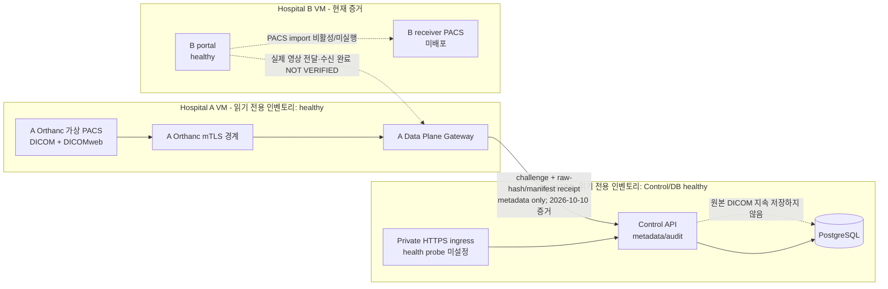
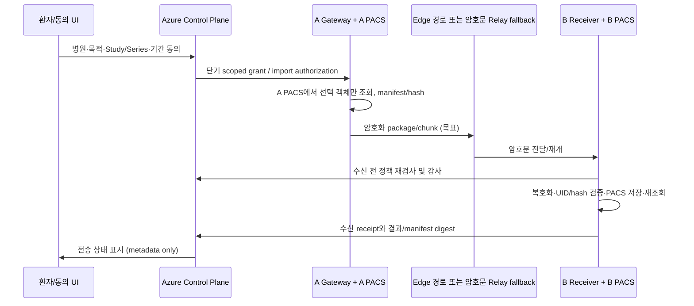

# Highpass 개발자 인수인계 및 프로젝트 현황서

## 1. 문서 개요

| 항목 | 내용 |
|---|---|
| 목적 | 신규 개발자가 저장소의 현재 구현·운영 증거·미완료 작업을 구분하고 안전하게 다음 작업을 시작하도록 안내 |
| 대상 | 백엔드·프론트엔드·보안·인프라 개발자, 기술 리드, 캡스톤 평가자 |
| 작성 기준일 | 2026-10-13 (Asia/Seoul) |
| 저장소 | `C:\Users\user\Documents\New project`, remote `origin` → `https://github.com/sureasdufo1-hue/Highpass-Project.git` |
| branch / HEAD | `codex/wbs-12-key-release-20260912` / `c1040c8439a0bdb78c68a7a83a73d84bc2704f31` |
| 적용 범위 | 저장소 문서·코드·Git 상태 및 2026-10-13 읽기 전용 VM 인벤토리, 2026-10-10 A 원본 증명/Control 등록 증적 |
| 변경 범위 | 본 인수인계 문서 추가만 수행. 서비스 코드·API·DB migration·배포 설정은 변경하지 않음 |

이 문서는 실제 파일과 증적을 우선한다. 과거 `PASS`는 그 문서가 지정한 SHA·환경·시나리오에서만 유효하다. 저장소에 문서/시험 코드가 있다는 사실은 실행 또는 배포 증거가 아니다. 최신 VM 결과도 `DRAFT / UNASSIGNED`이므로 사람의 독립 검토·승인을 대신하지 않는다. 비밀값이나 개인키는 조사·문서에 복사하지 않았다.

작업트리는 조사 중에도 바뀐 것으로 관측됐다. 최초 snapshot은 tracked 변경 49개·untracked 317개였고, 문서 작성 후 최종 snapshot은 tracked 변경 50개·untracked 322개(이 문서 포함)다. 이 문서 외의 순증가 1 tracked/4 untracked는 본 작업에서 생성한 것으로 확인할 수 없어 사용자/외부 변경으로 간주하고 건드리지 않았다.

상태 표기: `IMPLEMENTED` 코드 존재 확인, `VERIFIED` 해당 범위의 실행 증거 확인, `PARTIAL` 일부만 구현, `PLANNED` 설계/계획만 존재, `BLOCKED` 선행 환경·결정 부재, `DEFERRED` 범위에서 의도적으로 제외, `UNKNOWN` 저장소 근거만으로 판단 불가, `NOT VERIFIED` 이번 현재 기준으로 실행 증거 없음.

## 2. Executive Summary

Highpass는 환자 동의와 병원·의료진·Study 범위 정책을 이용해 병원 간 의료영상 조회와 전달을 통제하려는 합성 데이터 기반 MVP/PoC다. 기존 로컬 MVP에는 Node.js ESM Control Plane, PostgreSQL/JSON 저장소, Orthanc 가상 PACS, DICOMweb QIDO/WADO, Gateway/mTLS, Viewer, 동의·RBAC/ABAC·단기 토큰·감사 흐름이 있다. Mobile-Core와 v3는 일부 도메인/웹 시뮬레이션 및 설계 자산은 있으나, 실제 모바일 보안영역과 완전한 환자 승인→키 해제→B PACS 전송의 검증 완료 상태는 아니다.

현재 저장소의 기준 문서는 v2.1을 실행·회귀 자산으로 보존하고 Highpass v3를 제품/설계 목표로 삼는다. `docs/REQUIREMENTS.md`는 v3 목표선 수립을 설명하지만 PM·지도교수·의료정보·보안 검토의 승인 일자는 미정이다. 따라서 v3를 사람 검토까지 완료된 기준선이라고 표현하지 않는다.

10월 13일 읽기 전용 증거에는 A VM의 Orthanc, mTLS proxy와 A Gateway가 `running/healthy`, Azure Control API·PostgreSQL이 `running/healthy`, B 포털이 `running/healthy`로 기록됐다. 다만 B에는 PACS 컨테이너가 없고 암호화 저장 마운트도 준비되지 않았으며, B import와 동의 생성은 실행되지 않았다. 10월 10일 A 원본에서 합성 700개 인스턴스의 해시/매니페스트 보고가 Azure Control에 접수되고 메타데이터 카탈로그에 반영된 증거는 있다. 이는 A→Control의 원본 증명이지 A→B 영상 송신 또는 B PACS 수신 완료가 아니다.

**현재 Highpass는 A 원본 PACS와 Azure 메타데이터 Control의 실행 증거는 일부 확보했지만 B PACS 수신 완료는 미검증이며, 다음 단계는 B의 암호화 저장소·수신 PACS를 안전하게 준비하고 단일 합성 인스턴스부터 실제 읽기-쓰기-재읽기 해시와 Azure 완료 보고를 연결하는 것이다.**

## 3. 프로젝트 목적 및 서비스 시나리오

기존 CD 전달은 발급·이동·등록 지연과 수동 작업을 만든다. Highpass의 핵심은 원본을 보유한 병원(A)의 PACS에서 승인된 최소 범위만 조회하거나, 필요한 경우 수신 병원(B)의 PACS에 편입하고, 동의·목적·기관·의료진·Study/Series 권한 및 행위를 감사 가능한 형태로 묶는 것이다.

주요 주체:

| 주체 | 책임 |
|---|---|
| 환자 | 공유 동의·범위·기간·목적 결정 및 철회. 현재 웹/테스트 계정 중심이며 실환자 본인인증은 없음 |
| A 병원 의료진/PACS | 원본 DICOM의 Source of Record. 현재 A VM의 Orthanc가 합성 PACS 역할 |
| A Gateway | Control의 권한 확인 뒤 A Orthanc에서 허용된 데이터/증명을 가져오는 병원 경계 컴포넌트 |
| B 병원 의료진/포털 | 승인된 범위 조회 또는 수신 요청. 현재 포털은 있으나 실제 PACS 수신 환경은 미준비 |
| Control Plane | 사용자·병원·동의·정책·권한·수신 보고·감사 메타데이터 관리. 현재 Azure 배치는 이미지 저장/프록시용이 아님 |
| B PACS Receiver | 향후 B Orthanc에 선택 객체를 등록하고 재조회·해시 확인 후 완료 증거를 Control에 남기는 구성요소. 현재 코드/Compose 후보 |

원격 조회와 전송은 다르다. QIDO-RS는 목록/메타데이터 검색, WADO-RS는 승인된 객체 조회를 위한 DICOMweb 동작이다. 실제 수신 PACS 편입은 B 저장소에 객체를 쓰고 재조회로 UID/원본 hash를 확인해야 한다. 화면에 영상이 보임, source manifest가 등록됨, 혹은 API가 200을 반환함만으로 수신 PACS 편입을 완료로 간주하지 않는다. 목표 문구는 “실시간 생중계” 대신 **On-demand Retrieval / Progressive Remote Viewing**을 사용한다.

현재 증거는 합성 자료에 한정한다. 실제 환자·병원망·임상 판단·운영 PACS는 범위 밖이다.

## 4. 현재 시스템 아키텍처

### As-Is: 2026-10-13 증거 기준



최신 증거 근거: `artifacts/workstation/b-pacs-implementation-20261013-inventory/result.json`, `hcc-b-import-readiness-20261013T004523Z/result.json`, `b-pacs-storage-20261013T005931Z/result.json`, `hcc-source-live-integration-20261010T141812Z/result.json`. 이 파일들은 Git clone에 포함되지 않는 로컬/ignored 증적이고 모두 `DRAFT / UNASSIGNED`다. A Gateway의 자체 health와 A Orthanc health는 실제 영상 요청·B 저장 완료의 대체 증거가 아니다.

### To-Be: 목표 구조, 일부 설계/구현 후보이며 완전한 승인·검증 아님



목표 아키텍처 선택은 추가 ADR이 필요하다. 저장소의 v3 baseline/requirements에는 “Cloud Temporary Exchange Copy” 문구가 있으나 최신 `docs/ARCHITECTURE.md`와 사용자 제공 원칙은 Azure Control을 metadata-only로 두고 원본/장기 저장을 금지한다. Cloud Relay 허용 범위·암호문 TTL·삭제 증적은 아직 정합되지 않았다. 본 인수인계는 현재 Azure에서 영상 payload를 저장한다고 가정하지 않는다.

네트워크·신뢰 경계: A Orthanc 내부망, A mTLS proxy와 A Gateway, B Portal과 향후 별도 B PACS 내부망, Azure private ingress/Control/DB를 분리한다. mTLS는 통신 상대 인증이며 환자 동의·사용자 RBAC/ABAC·Study scope 판단 그 자체가 아니다. 자세한 목표 위협/흐름은 `docs/architecture/THREAT-MODEL.md`, `docs/architecture/DATA-FLOW.md`, `docs/security/dicom-access-flow.md`를 참조한다.

## 5. 기술 스택 및 저장소 구조

| 구분 | 기술/버전 | 역할 | 주요 경로 | 상태 |
|---|---|---|---|---|
| Backend | Node.js ESM, package engines `>=20`; 조사 PC Node `v24.18.0` | Control API, Gateway, 인증·정책·감사, 시나리오 서버 | `src/`, `scripts/` | IMPLEMENTED; 현 worktree 전체 재검증 NOT VERIFIED |
| DB | PostgreSQL; `pg ^8.13.1`; 구성 문서의 PostgreSQL 16 | Consent, identity, grants, audit, exchange 데이터 | `db/migrations/`, `src/postgres-store.js` | 사용 코드/DDL 존재. 실제 cloud DB health 확인, 최신 migration 정합성 NOT VERIFIED |
| Frontend | 정적 HTML/CSS/Vanilla JS | 환자·의료진·관리/시연 UI | `public/`, `public/ui/` | 구현됨; 일부 최신 화면은 미커밋 |
| Mobile | `public/mobile/` 기반 웹/PWA 시뮬레이션 | QR·handoff·wallet 경험 | `public/mobile/`, `src/mobile-*.js` | native iOS/Android, Secure Enclave/TEE NOT IMPLEMENTED/NOT VERIFIED |
| PACS | Orthanc 합성 PACS | 원본/목적지 시험 저장, DICOM REST·DICOMweb | `orthanc/`, `Dockerfile.orthanc`, Compose | A 실제 컨테이너 healthy 증거; B PACS 미배포 |
| DICOMweb | Orthanc DICOMweb plugin, QIDO-RS/WADO-RS | 승인 범위 목록·객체 조회 | `src/orthanc-client.js`, `src/data-plane-gateway.js` | 로컬 MVP 과거 시험 있음; 최신 전체 E2E 재실행 안 함 |
| Gateway | Node HTTPS/mTLS proxy 및 A Data Plane Gateway | Trust boundary, scoped PACS access, source proof | `src/data-plane-gateway.js`, `scripts/data-plane-gateway.js`, `infra/workstation/` | A VM health/current source proof 일부 확인 |
| 인증/인가 | 자체 JWT/test auth, consent + RBAC/ABAC, DPoP 경로 | 사용자/서비스 인증과 scope별 정책 | `src/auth.js`, `src/services.js`, `src/data-plane-authorization.js` | 구현됨; 실제 외부 IdP/MFA 미연동 |
| 암호화/키 | TLS/mTLS, AES-GCM/package·key-release 도메인, Azure Key Vault 연동 자산 | 전송·package 보호 | `src/capstone-encrypted-transfer.js`, `src/consent-bound-key-release.js`, `infra/azure/` | 단위/모의 경로와 문서 있음; 운영 KMS/HSM 및 실제 키 흐름 NOT VERIFIED |
| Container/Infra | Docker Compose, Azure VM Compose 배치, A/B VMware VM 설정 | 개발·캡스톤 구성 | `docker-compose.yml`, `infra/azure/`, `infra/workstation/` | Azure/A/B live snapshot 있음; local stack은 현재 running service 없음 |
| CI/CD | GitHub Actions workflow | 보안 gate·staging validation | `.github/workflows/security-gate.yml`, `staging-validation.yml` | workflow 존재; 이번 조사에서 workflow 실행 여부 재검증 안 함 |
| Test | Node built-in `node:test`, Python unittest/스크립트, browser check | 단위·통합·보안·운영 preflight | `test/`, `scripts/` | 시험 대량 존재; 현 worktree에서 실행하지 않음 |

주요 디렉터리:

```text
src/                 API, policy, auth, DB adapter, DICOM gateway, privacy/mobile domains
public/              환자·병원·관리 UI와 web mobile/PWA
test/                단위·통합·보안·브라우저 계약 시험
scripts/              기동, 검증, 배포/preflight 및 synthetic data 도구
db/migrations/       순차 PostgreSQL schema 및 policy migration (현재 001–037 파일)
infra/azure/         Azure VM/Compose/네트워크/key-release 배치
infra/workstation/   A/B VM Compose overlay 및 VMware VM 템플릿
orthanc/             A PACS 및 B 수신 PACS 설정
docs/                요구사항, 아키텍처, 보안, 운영, PHR, Privacy, 증거
artifacts/           ignored 로컬 실행/원격 VM 증적 (clone에 자동 포함되지 않음)
```

먼저 읽을 코드: `src/server.js`(route와 Control API), `src/services.js`(동의·정책·감사 도메인), `src/data-plane-gateway.js`(Data Plane), `src/hcc-source-probe.js`/`src/hcc-source-verification.js`(A 증명), `src/b-pacs-receiver.js`(B PACS 후보), `src/pacs-import-engine.js`(구 local archive simulator). 배포는 실제 호출 entrypoint인 `scripts/start-capstone-control.js`, `scripts/start-capstone-b-portal.js`, Compose overlay와 함께 확인한다.

## 6. 기능별 구현 현황

| 기능 | 요구 목적 | 구현 상태 | 주요 코드/문서 | 검증 근거 | 남은 작업 |
|---|---|---|---|---|---|
| 동의 생성·조회·철회 | 환자 명시 동의 및 revoke 차단 | IMPLEMENTED | `src/services.js`, `src/server.js` | 과거 local/API·PG 증거; 현재 변경 코드 미재실행 | 최신 cloud DB migration/RLS와 UI 전체 흐름 재검증 |
| 접근정책 | 기관·사용자·목적·permission·Study/Series 범위 | IMPLEMENTED | `src/services.js`, `src/data-plane-authorization.js` | 과거 negative tests 및 DPoP evidence | 새 v3 API와 현재 routes 정합성, 전체 거부 행렬 재검증 |
| short-lived token/handoff | jti, scope, expiry/revoke 및 QR로 권한 전달 | PARTIAL | `src/auth.js`, `src/services.js`, `public/mobile/` | legacy handoff 및 test evidence | 실제 mobile secure storage/실기기·재사용/오프라인 시험 |
| A PACS·DICOMweb | 합성 PACS의 QIDO/WADO | IMPLEMENTED; 일부 VERIFIED | `orthanc/hospital-a.json`, `src/orthanc-client.js` | 10/13 A Orthanc 2개 컨테이너 healthy; 10/10 700-object source hash receipt | 실제 현 B viewer 조회 및 10/13 이후 source freshness 재검증 |
| A PACS 송수신 capability | DICOM association 또는 REST upload capability | PARTIAL | `orthanc/hospital-a.json` (`DicomServerEnabled:true`, port 4242) | A 서비스 존재/health 확인. C-STORE association·outbound peer는 NOT VERIFIED | A modality/`DicomModalities` 및 firewall·C-STORE 시험 확인 |
| A Gateway↔Azure report | source proof/manifest metadata 제출 | VERIFIED — 한정 | `src/hcc-source-probe.js`, `src/hcc-source-verification.js`, `src/server.js` | `hcc-source-live-integration...result.json`: 700 instance/1 series receipt/catalog commit ACK, 10/10 | ownership/consent/browser 별도, 최신 반복/장애·중복 시험 |
| B portal | 수신 병원 UI/HTTPS entry | IMPLEMENTED; runtime VERIFIED — health only | `src/capstone-b-portal.js`, `scripts/start-capstone-b-portal.js` | 10/13 portal healthy | PACS receiver network, encrypted mount, full import path |
| B PACS 실제 편입 | 선택 객체를 Orthanc에 저장하고 read-back UID/hash 확인 | PARTIAL / NOT VERIFIED | `src/b-pacs-receiver.js`, `infra/workstation/hospital-b-pacs-receiver.compose.yml` | 목적 시험 `test/b-pacs-receiver.test.js` 존재(이번 미실행); 10/13 destinationPacsContainers `[]`, importExecuted false | host LUKS mount, dedicated mTLS, image scan/review, deploy, synthetic import/readback |
| 레거시 PACS import | B archive에 전달 상태 기록 | PARTIAL/SIMULATED | `src/pacs-import-engine.js` | 코드에 `LOCAL_ENCRYPTED_ARCHIVE_SIMULATOR`, destinationVerification false | 실제 B PACS 영수증으로 대체·명시적 simulator label 유지 |
| 암호화 패키지·key release | AES-GCM, key-release policy | PARTIAL | `src/capstone-encrypted-transfer.js`, `src/consent-bound-key-release.js` | domain/contract tests 및 설계. 실제 VM의 payload→B Vault 미검증 | 실제 키 서비스, 중단/재개·삭제·device binding E2E |
| DB/migration/RLS | metadata persistence, tenant isolation | IMPLEMENTED; mixed VERIFIED | `db/migrations/` (현재 파일 001–037), `src/postgres-store.js` | PostgreSQL/RLS 과거 PASS 문서, Azure PG healthy snapshot | untracked migration 037와 현재 live schema 비교, migration replay/rollback |
| 전송 암호화/mTLS | 병원 Gateway/PACS 및 private API trust | IMPLEMENTED; limited VERIFIED | `infra/workstation/hospital-a*.compose.yml`, `scripts/capstone-mtls-check.py` | historical negative tests, current containers healthy only | current A/B cert chain/peer handshake/expiry 직접 재확인 |
| 저장 암호화 | B local at-rest 보호, cloud retention 정책 | PLANNED/PARTIAL | B receiver compose의 verified encrypted mount gate, `docs/compliance/RETENTION-AND-DELETION.md` | B mount preflight says intended mount absent; cloud DB mount exists | LUKS ready, TTL/delete evidence; cloud DICOM persistent storage prohibited unless ADR |
| 감사로그/abuse detection | allow/deny, hash-chain, transfer lifecycle | IMPLEMENTED; partial runtime VERIFIED | `src/services.js`, `src/server.js`, DB migrations | historical local integrity evidence; A source proof audited receipt | 실제 B receipt correlation, immutable export/WORM, current audit recovery |
| FHIR/ImagingStudy | PHR와 imaging metadata 연계 | PARTIAL | `docs/phr/`, `src/` PHR modules, `docs/phr/IMAGINGSTUDY-DICOM-MAPPING.md` | 과거 synthetic mapping tests/report | 실제 external FHIR/기관 profile 미연동; current regression 재실행 |
| Privacy Filter | 연구/AI 목적 최소화·검토·반출 게이트 | PARTIAL / model BLOCKED | `src/privacy-policy.js`, `docs/privacy/` | PF-0 DB gate 및 fake model loopback HTTP 증거는 dated | 실제 모델/checkpoint, quality eval, real DICOM image de-identification 및 release E2E |
| Admin/monitoring | 운영 상태·감사·이상행위 | PARTIAL | `public/`, `src/server.js`, `scripts/` | historical local checks | 실제 RBAC dashboard, SIEM/WORM, DR/load/staging |

`test/b-pacs-receiver.test.js`는 source hash, 승인 전 import, Orthanc 저장 후 재조회, UID/hash, audit completion fail-closed를 검사하도록 작성됐지만 이번 문서 작업에서 실행하지 않았다. 시험명이나 test fixture만으로 `VERIFIED`로 승격하지 않는다.

## 7. 주요 데이터 및 API 흐름

### 기존 동의/원격 조회 흐름 — 구현 자산

시작 조건: 개발/합성 사용자, 가상 병원·환자, 허용 Study/Series. 환자 동의 생성/조회/철회 API는 `src/server.js`에서 `src/services.js`로 전달된다. 서비스가 ACTIVE 상태·시간창·병원·목적·permission·Study/Series 범위를 판정하고 감사로그를 만든다. 권한 요청은 단기 DICOMweb token/scope를 발급한다. `/dicomweb/...` route는 token/claim과 request scope를 확인한 뒤 Gateway/Orthanc 쪽으로 검색 또는 객체 요청을 전달한다. 권한 실패는 이유 코드로 거부하고 실패 감사를 남긴다. 실제 전체 HTTPS E2E는 예전 local baseline에서 PASS 기록이 있으나 현 worktree의 현재 테스트는 실행하지 않았다.

### A 원본 증명 → Azure Control 보고 — 현재 한정 VERIFIED

2026-10-10 A Gateway가 Control에서 고정 synthetic dataset challenge를 받고 mTLS로 A Orthanc QIDO/resource/raw instance를 조회하여 manifest와 raw SHA-256 증명 보고를 제출했다. Azure Control은 receipt를 발급하고 고정 receipt-bound metadata catalog 등록 commit/read-back 확인을 기록했다(700 instance, 1 series, 1 study). 증적 `artifacts/workstation/hcc-source-live-integration-20261010T141812Z/result.json`의 `ownership=NOT CHANGED`, `consent=NOT ISSUED`, `browser=NOT VERIFIED`다. 원본 payload를 Azure Control에 저장하거나 B PACS로 전달했다는 의미가 아니다.

### B PACS 수신 목표 흐름 — 아직 실제 실행 안 됨

시작 조건은 유효한 consent/grant, B 병원·의료진·Device binding, 허용된 transfer scope, receiver health, 승인된 암호화 저장소, 전용 B mTLS 인증이다. B portal이 import 경로를 받아 Control에서 import authorization을 받고, 승인된 instance 하나를 A Gateway에서 받는다. 수신기는 DICOM bytes의 source manifest hash/길이를 확인하고, 저장 전과 저장 직전 Control authorization/audit를 다시 확인한 후 B Orthanc REST `/instances`에 넣는다. 이후 B에서 instance UID와 raw bytes를 재조회해 hash를 비교하고, `PACS_VERIFIED` event/audit 저장 성공 뒤에만 완료 결과를 반환하도록 후보 코드가 구성돼 있다. 상태는 `src/b-pacs-receiver.js`에 있으며 `scripts/start-capstone-b-portal.js`는 환경 gate가 모두 통과하기 전 receiver를 default-off로 둔다. 10/13 evidence에는 B PACS가 없고 import는 실행되지 않았다.

### 모바일 보관함/QR/key release 목표 흐름

웹/PWA 시뮬레이션과 package/key-release domain이 있으나 native app, hardware-backed key, real mobile Vault와 전체 DICOM package 이동은 NOT VERIFIED다. QR은 PHI가 아닌 opaque, 짧은 수명의 일회성 요청 식별자여야 하며 QR 단독으로 데이터/DEK를 풀 수 없어야 한다. 현재는 환자 동의·ticket 로직과 일부 UI가 있다고 해서 모바일 저장·복호화 기능이 완성된 것으로 보지 않는다.

## 8. 보안 아키텍처 및 개인정보 처리

| 보안 주제 | 현재 근거와 판정 |
|---|---|
| 보호 대상 | DICOM pixel data, DICOM metadata/UID, patient reference, consent, user/device identity, access token, audit/provenance |
| 개인정보 경계 | 원본은 A PACS, policy/consent/audit metadata는 Control. Azure Control은 현재 `HIPASS_CONTROL_PLANE_ONLY=1` 구성으로 영상 경로를 막도록 설정 |
| 인증/인가 | 인증 주체와 서비스 계정, RBAC+ABAC/scope 구분이 코드에 존재. 실제 external OIDC/JWKS/MFA는 미연동 |
| 최소 권한 | short-lived scope/token, Gateway service identity, internal API scopes, DB roles/RLS 관련 migration/시험 존재. 최신 schema/runtime 종합 재검증은 미완료 |
| 동의 | ACTIVE/REVOKED/EXPIRED, 기간·기관·목적·Study/Series와 VIEW/DOWNLOAD 구분을 검사하는 코드. 실제 환자 동의/법적 적합성 아님 |
| Token | token hash/jti와 issuer/audience/expiry/scope 경로가 구현 문서·코드에 존재. 최신 branch의 모든 경로를 exhaustive review/test하지 않음 |
| mTLS/TLS | A Gateway↔A Orthanc 경계 및 cloud private TLS 구성 있음. A/B VM의 container health만으로 매 peer 인증이 확인되지는 않음 |
| 저장 암호화/키 | package encryption/key release code와 Azure Key Vault infrastructure 문서 존재. Azure VM에서 실제 Key Vault wrap/unwrap 및 lifecycle은 NOT VERIFIED |
| 감사/무결성 | audit hash chain, append/deny logic, A source receipt report. WORM/SIEM integration 및 실제 B receipt 전체 연결 미완료 |
| fail-closed | B receiver candidate는 authorization/audit 실패 시 import 중지하고 완료를 거짓 표시하지 않도록 구성. VM receiver 미배포 |
| logging | secret sanitization/test 코드 존재. 최신 VM 로그에서 PHI/token 전체 scan은 실행하지 않음 |

위협모델은 저장소의 `docs/security/threat-model.md`와 목표 `docs/architecture/THREAT-MODEL.md`를 비교한다. 실제 threat exercise/침투시험, 모바일 분실/탈옥, KMS/HSM, 병원 인증·네트워크, 법무/개인정보 책임자 승인은 별도다. 설계 파일이나 과거 gate만으로 운영 통제를 검증했다고 말하지 않는다.

## 9. Privacy Filter 현황

관련 기준 문서는 `docs/privacy/highpass-medical-privacy-policy-decision-spec-v1.0.md`, `highpass-privacy-filter-implementation-plan-v1.0.md`, `CURRENT-WORK-CLASSIFICATION.md`, `PF0-PF1-EXECUTION-REPORT.md`, `README.md`다. 두 설계 기준서는 등록부에서 `NORMATIVE DRAFT`/구현계획으로 분류되며 법률·병원 정책 승인은 아니다. `references/*prompt.md`는 명시적으로 `NON-NORMATIVE INPUT`; 이를 요구사항/승인으로 사용하지 않는다.

Privacy Filter의 목적은 연구·AI 등 비진료 목적의 텍스트/지원 DICOM 사본에서 민감 정보를 탐지·마스킹·검토하고 반출 조건을 판정하는 것이다. 진료 원본 조회·동의 권한과 분리한다. policy evaluator의 판정, detector/model 결과, 변환기 및 release approval은 서로 다른 단계다. 모델 점수나 preview만으로 반출 권한을 내주지 않는다.

현황: PF-0의 local PostgreSQL/migration/RLS Gate는 2026-09-09 역사적 PASS 기록이 있다. PF-1에는 API contract, fake adapter/규칙 기반 preview, loopback 격리 HTTP, deadline/abort, 최소권한 identity 시험 기록이 있다. 실제 OPF model/checkpoint smoke는 문서에서 `EXPLICIT_CHECKPOINT_REQUIRED`/`ENVIRONMENT BLOCKED`; actual model, latency/quality 평가 미검증. PF-2의 durable artifact, approved copy bytes/version binding/release flow 등과 PF-3 이후는 현 작업 분류상 PARTIAL/NOT IMPLEMENTED다. 최신 코드 변화는 존재하지만 이번 turn에서 privacy suite를 실행하지 않았다.

권장 다음 순서: (1) 정책 명세의 미결정값·승인자 확인, (2) 실제 로컬 model/checkpoint 공급·digest/라이선스 확인, (3) 합성 평가 집합에서 detector/Unicode/임상정보 보존 품질 평가, (4) 원본 불변·approved copy byte binding과 review ledger 구현, (5) fail-closed release gate와 audit, (6) 지원하는 합성 DICOM만 파싱/정제/재검증. 얼굴/픽셀 de-identification을 header 삭제만으로 완료라고 주장하지 않는다.

## 10. 개발 진행상황 및 Phase 이력

| 단계/기록 | 문서에 기록된 결과 | 범위/기준 | 현재 적용성 |
|---|---|---|---|
| Phase 2 환경 | PASS | `docs/governance/phase-2-environment-validation.md`, SHA `22f9df96...`; Docker/Compose, HTTPS, services, cert | 역사적 로컬 기준. 현재 local compose `ps`는 실행 서비스 없음 |
| Phase 3 MVP E2E | PASS, 14 stages | `docs/governance/phase-3-mvp-end-to-end-validation.md`, 날짜 기록과 local 합성 범위 | 역사적; 현재 dirty worktree 재실행 안 함 |
| Phase 4 복구/시연 | PASS | local Compose 복구·Viewer/HTTPS·재현 시험 | 역사적; VM/운영이 아님 |
| Phase 5 발표 패키지 | PASS/기술 발표 handoff | `docs/governance/phase-5-presentation-package-freeze.md`; test/gate·증적 DRAFT/UNASSIGNED | 역사적 local synthetic only |
| Phase 6 evidence index | 과거 W09/W10와 9/11 gate 기록 | `docs/evidence/phase-6-evidence-index.md`, SHA `343021d...`/`96e20cd...` 등 각 subsection 기준 | 현재 HEAD보다 앞선 역사적 기록; 그대로 최신 PASS 승계 불가 |
| Azure/A/B 분산 HCC | A source receipt/catalog 한정 PASS; 10/13 A/Azure containers health snapshot | 10/10 exact source receipt; 10/13 read-only inventory | DRAFT/UNASSIGNED; B import absent; external/clinical use 아님 |
| 전체 v3/production | 완료 증거 없음 | `/api/v3`, 운영 IdP/KMS/HSM, actual PACS, mobile device, external staging/DR | NOT VERIFIED / NOT PRODUCTION READY |

`docs/baseline/CAPSTONE-MVP-BOUNDARY.md`의 P0 표는 MVP-08 `STOW-RS → B Orthanc`를 “Expected PASS”라는 표에 두면서 설명은 구현 후 실행된 시험만 PASS라 한다. 이를 완료 실적으로 인용하지 말고 actual 10/13 B readiness evidence와 대조한다. 마찬가지로 예전 Phase PASS는 현재 branch/worktree와 같은 소스가 아니라면 역사적 결과다.

## 11. 미완료 작업 및 Blocker

| 우선순위 | 작업 | 현재 상태/차단 | 다음 조치 |
|---|---|---|---|
| P0 | 변경 작업트리 인수·분류 | HEAD `c1040c8`; 최종 snapshot 50 tracked changed / 322 untracked(이 문서 포함). 조사 중 이 문서 외의 1 tracked/4 untracked 추가 변경이 관측됨. UI·서버·migration·B receiver·증적 산출물 동시 존재 | 파일별 KEEP/REVIEW/EVIDENCE 분류, test-source 연결·secret scan·diff check. 임의 revert/clean 금지 |
| P0 | 요구사항/아키텍처 baseline 승인 및 상충 정리 | v2.1 실행 자산, v3 target; 사람 승인 미기록. Cloud temporary exchange copy vs metadata-only/cloud relay 규정이 상충 | ADR에서 이미지 경로·보관·relay TTL·모바일 범위·승인자/일자를 명시 |
| P0 | B PACS 수신 환경 | 10/13 B portal만 healthy; PACS container 없음, encrypted mount false, importExecuted false | B host encrypted mount 확인, dedicated mTLS issuance, image pin/scan, Compose contract review 후에만 수신기 배치 |
| P0 | A→B 실제 영상 수신 보고 | A→Control source proof는 10/10 증거 있음; B PACS readback receipt 없음 | 첫 synthetic instance로 authorization→transfer→B store→readback UID/hash→Control audit를 끝까지 실행 |
| P1 | current DB/migrations | cloud PostgreSQL healthy이나 latest working tree migration 037 untracked; live schema version unknown | readonly schema/migration inventory와 current container image/source SHA 비교, 중복 적용/upgrade rehearsal |
| P1 | mTLS/certificate lifecycle | local development cert renewal doc는 2026-12-07까지 기록; VM live chain/expiry는 별도 확인 필요 | `ops:expiry`, A/B/cloud peer cert metadata·SAN·issuer 검증; 실 cert/keys 출력 금지 |
| P1 | Azure report/operations | Azure Control/DB healthy snapshot; ingress probe not configured; Azure CLI 미설치 | receipt status API/read UI, correlation/idempotency, alerts, immutable audit export 계획; Azure Monitor는 보조 telemetry |
| P1 | Mobile-Core | web/PWA와 domain pieces; native app/TEE/keychain/real QR custody 없음 | Device registry → package contract → crypto receiver → handoff → key release를 독립 vertical slice로 분리 |
| P1 | Privacy Filter | PF-1 fake/loopback 범위 PARTIAL, 실제 model blocked, PF-2+ 미완료 | checkpoint/quality prerequisites와 approved policy values부터 닫음 |
| P2 | 외부 staging/실제 IdP·KMS·PACS·SIEM·DR | 자원·승인 미제공/미검증 | 캡스톤과 productionization을 분리하고 자원·담당자·예산·DoD 확정 |

호스트에 `az`, VMware `vmrun`/GUI 명령은 탐지되지 않았고 local root Compose project에는 running service가 보이지 않았다. 그럼에도 원격 VM snapshot artifact는 존재한다. 따라서 저장소/로그인 없이 Azure 또는 VM을 지금 직접 조작할 수 있다고 가정하지 않는다.

## 12. 신규 개발자 로컬 실행 가이드

다음 명령은 저장소의 `package.json`, `README.md`, `docs/DEMO-RUNBOOK.md`에 있는 개발/합성 환경용 명령이다. 현재 조사에서는 실행하지 않았다. `.env`를 덮어쓰지 않도록 먼저 존재 여부를 확인한다.

```powershell
node --version
pnpm --version
docker version
docker compose version
if (-not (Test-Path .env)) { Copy-Item .env.development .env }
pnpm install
pnpm run mvp:start
pnpm run mvp:readiness
```

기본 로컬 주소는 문서 기준 `https://localhost:3443/hipass/`(포털), `https://localhost:3443/`(OHIF), `http://localhost:3000`(HTTP/API), `https://localhost:3443/api/health`(health)다. 실제 현재 cert/trust와 endpoints는 기동 후 readiness로 확인해야 한다. synthetic Orthanc data는 `scripts/load-sample-dicom.js` 또는 승인된 demo runbook 경로를 따른다.

```powershell
# 단위/통합 회귀
pnpm test

# MVP orchestration/E2E: Docker Compose가 필요
pnpm run mvp:verify

# 추가 게이트(각 명령은 환경 의존성이 있으므로 README/runbook 확인)
pnpm run security:secrets
pnpm run security:gate
pnpm run test:mtls-negative
pnpm run e2e:https
```

Mobile은 native app이 아니라 같은 HTTP server의 `/mobile/` web/PWA demo로 취급한다. 별도 mobile package/build 명령은 확인되지 않았다. PostgreSQL-only local start command는 `docker compose up -d postgres` 이후 `pnpm run start:postgres`로 문서화되어 있다. Azure `pnpm run azure:preflight`는 preflight 명령이지 Azure deploy 명령이 아니다. `pnpm run mvp:cleanup` 또는 `docker compose down -v`는 데이터에 영향 줄 수 있으므로 실행 전 볼륨·프로젝트명·synthetic data를 확인한다. 실제 환자 데이터는 사용하지 않는다.

조사 host versions는 Node `v24.18.0`, pnpm `11.7.0`; Docker client command는 발견됐고 `docker compose ps`는 default root project에서 실행 서비스 없이 끝났다. Docker daemon 전체 readiness·개발 인증서·모든 의존성은 이번에 검증하지 않았다.

## 13. 테스트 및 품질 현황

| 테스트 영역 | 실제 명령/기록 | 최근 확인 가능한 결과 | 기준 SHA/환경 | 현재 재검증 |
|---|---|---|---|---|
| Node unit/integration | `pnpm test` / dated phase reports | Phase 4 문서 125/125, 9/11 docs 148/148 | 각 보고서의 옛 local SHA; current HEAD 작업트리 아님 | NOT RUN |
| MVP local E2E | `pnpm run mvp:verify` | Phase 3 14/14; Phase 5 문서 14/14 | 해당 dated reports | NOT RUN; local Compose empty |
| HTTPS/mTLS/network | `pnpm run e2e:https`, `pnpm run test:mtls-negative`, `pnpm run security:network` | 역사적 PASS 기록 | 예전 local synthetic stack | NOT RUN |
| PostgreSQL/RLS/PF-0 | `pnpm run privacy:db-gate` | 2026-09-09 local PG16 report PASS | `docs/privacy/PF0-PF1-EXECUTION-REPORT.md` 등 | NOT RUN |
| B PACS receiver | `node --test test/b-pacs-receiver.test.js` | 시험 파일 존재; 실행 결과 주장 안 함 | 미커밋 worktree candidate | NOT RUN |
| Source receipt/catalog | `scripts/hcc-source-live-integration.py` 실행 증거 | 2026-10-10 PASS: source raw hashes/receipt/catalog metadata only | `artifacts/workstation/hcc-source-live-integration-20261010T141812Z/result.json` | 당시 실제 실행 확인, 최신 반복 NOT RUN |
| VM readiness | read-only inventory/preflight artifacts | 2026-10-13 A & Azure services healthy; B PACS absent | artifact review `DRAFT / UNASSIGNED` | snapshot 확인, current connectivity 재시험 안 함 |
| Actual PACS transfer | B import readiness | 2026-10-13 `importExecuted:false`, no destination PACS | `hcc-b-import-readiness...result.json` | 미실행/NOT VERIFIED |
| Privacy model quality | `pnpm run privacy:model-smoke` | 기록상 checkpoint 부재로 environment blocked | `docs/privacy/CURRENT-WORK-CLASSIFICATION.md` | NOT RUN |

이번 조사에서는 테스트 suite, migration, deployment, certificate checker를 실행하지 않았다. 따라서 이번 기준의 자동화 테스트 결과는 `NOT VERIFIED`다. 최근에 미커밋된 테스트 파일이 많으므로 과거 수치로 현재 코드의 품질을 보증하지 않는다.

## 14. 주요 설계 의사결정 및 변경 이력

| 배경 | 선택/현 상태 | 영향·미결정 |
|---|---|---|
| CD/전체 복사 방식의 지연 | v2.1에서 A PACS 원격 QIDO/WADO 조회와 필요한 경우 선택 전송을 유지 | “조회 성공”과 “B에 영구 편입” lifecycle/API가 명확히 분리되어야 함 |
| 제품 목표 통합 | v2.1은 실행·회귀 자산, Mobile-Core 자산은 v3 P1/공통 package, v3는 목표 baseline (`docs/REQUIREMENTS.md`) | formal PM/clinical/security/legal architecture sign-off 및 승인일 없음 |
| 원본 저장 위치 | Source of Record는 A PACS/Orthanc | Control DB에 DICOM 원본을 지속 저장하지 않음 |
| Azure 역할 | 실제 배치에서 Control API/DB metadata, private ingress; Azure VM snapshot health 확인 | `docs/REQUIREMENTS.md` temporary exchange copy 및 relay fallback 문구와 최신 metadata-only architecture를 ADR에서 정리 |
| DICOM 전달 | QIDO/WADO 원격 조회 우선; B STOW/Orthanc import는 목표와 candidate code | `MVP-08 expected PASS` 표는 실행 성과가 아님. B 수신은 실제 destination PACS와 receipt로 입증해야 함 |
| Mobile/QR | QR opaque short-lived handoff, package encrypted storage 목표 | 현재 UI/PWA/도메인과 native secure vault/TEE를 혼동하지 않음 |
| Privacy Filter | 진료 원본 접근과 분리된 연구/AI copy/release policy | policy draft·actual model·quality/release E2E는 별도 승인 및 구현 |
| 운영 주장 | 합성 MVP/캡스톤 기술 검증만 수행 | PIPA 판정, ISMS-P, 병원 승인, production readiness로 확대 금지 |

Azure DICOM 서비스는 별도 선택 시 QIDO-RS/WADO-RS/STOW-RS를 지원하는 관리형 DICOMweb 저장·교환 서비스다. 하지만 현재 Highpass Azure compose에는 그 연동이 확인되지 않았고, cloud 원본 지속 저장 금지 방향과도 별도 ADR 없이 결합할 수 없다. 현재 목표에서는 metadata-only receipt를 Azure Control에 보고하고 B 병원 자체 PACS를 최종 저장소로 두는 편이 일관된다.

## 15. 다음 개발 단계 및 권장 순서

1. **작업트리 동결/분류 및 근거 고정** — 기존 변경은 사용자 작업이다. `git status`, source diff, untracked inventory와 생성 산출물을 분류하고 file purpose/secret scan/diff check를 남긴다. 완료 기준: 원복/삭제 없이 리뷰 가능한 커밋 제안이 있고, 각 테스트가 수정 코드와 대응한다.
2. **ADR/요구사항 정합성 승인** — v2.1/v3/Mobile-Core의 실행선·목표선, Cloud Relay/temporary copy/metadata-only, 모바일 범위와 handoff/transfer status를 하나의 결론으로 기록. 완료 기준: 승인자·일자·범위·거절된 대안·FR trace가 채워지고, 승인 전 migration/API 기능 변경 없음.
3. **B PACS 수신 환경 gate** — B local encrypted filesystem 확인, dedicated mTLS, pinned image scan, B Orthanc/MW contract와 Control authorization/audit 정합성 검토. 완료 기준: read-only preflight가 encrypted mount 및 PACS health 증거를 보이며, 공개 DICOM port가 없다. 완료 전 receiver overlay를 실행하지 않는다.
4. **한 인스턴스 실제 PACS 전달 vertical slice** — synthetic allowed object 1개로 before-import consent/audit → source hash → B write → destination readback UID/hash → `PACS_VERIFIED` audit. 완료 기준: revoked/expired/wrong hospital/wrong UID/hash tamper/audit outage에서 no import/false completion; cloud receipt metadata-only. 그 다음만 700-object batch/재개로 확대.
5. **Azure 수신보고 가시화와 무결성** — transferId/correlation, manifest digest, object count, source/destination receipt, status timestamps와 failure reason을 cloud Control API/화면/alert로 묶는다. 상태는 `SOURCE_VERIFIED`, `TRANSFER_AUTHORIZED`, `RECEIVING`, `DESTINATION_VERIFIED`, `FAILED/INCOMPLETE`처럼 단계별로 보인다. 완료는 B PACS readback + durable audit confirmation에만 부여한다.
6. **현재 dirty source로 회귀/보안 gates** — Node/contract → PG migrations/RLS → Compose → HTTPS/mTLS negative → Browser/Viewer → report/integrity sequence. DoD는 현재 SHA/worktree에서 실제 재실행 결과와 DRAFT 증거를 연결하는 것.
7. **Mobile-Core와 Privacy Filter** — 각각 independent vertical slices (Device registry → encrypted package → QR handoff → key release; PF model → reviewed copy → release audit)로 나눈다. Azure KMS/HSM, external IdP/MFA, WORM/SIEM, DR/load는 별도 staging resource gate.

이 순서는 최신 Blocker(목적지 PACS 없음)를 반영한다. 실제 병원망/환자 데이터/운영 credential로 우회 검증하지 않는다.

## 16. 신규 개발자 첫 주 온보딩 계획

| 일차 | 권장 순서 |
|---|---|
| Day 1 | `docs/REQUIREMENTS.md`, baseline/ADR, MVP boundary 읽기. v2.1 실행선과 v3 목표선, handoff 용어 확인 |
| Day 2 | 저장소/dirty worktree 목록 확인, `src/server.js`→`services.js` consent/API 흐름과 `src/data-plane-gateway.js` 읽기. 코드 변경은 보류 |
| Day 3 | `db/migrations/`, DICOM config, A/B Compose, `b-pacs-receiver.js` 및 report artifact를 읽고 source proof와 receiver completion 차이 설명 |
| Day 4 | 개발/합성 Docker stack을 새 담당자와 함께 띄우고 health/Node tests/negative mTLS runbook 재현. 데이터·volume 삭제 금지 |
| Day 5 | 작은 독립 업무(예: status/report contract 문서화 또는 한 receiver failure test) 하나를 선택, FR/NFR mapping·test·security impact를 붙여 리뷰 요청 |

Azure/VM 자격 증명은 별도 승인 경로로 제공받는다. repository artifacts에서 credential을 복사하지 않는다.

## 17. 인수인계 체크리스트

- [ ] 서비스 목적과 합성/비운영 범위 이해
- [ ] v2.1 현행 실행 자산과 v3 목표 baseline의 승인 상태 확인
- [ ] To-Be diagram과 As-Is evidence를 분리해서 이해
- [ ] 현재 branch/HEAD 및 49 tracked + 317 untracked 변경(문서 추가 전) 보존 확인
- [ ] Node/pnpm/Docker prerequisites와 `.env` 처리 확인
- [ ] 로컬 Compose readiness와 unit/negative tests를 직접 재현
- [ ] 동의·RBAC/ABAC·token·DICOMweb 흐름 추적
- [ ] A source proof가 B PACS receipt가 아님을 이해
- [ ] B PACS encrypted mount, receiver mTLS, real import이 아직 미완료임을 확인
- [ ] Azure Control report API/DB와 operational telemetry의 역할 구분
- [ ] Privacy Filter PF-1 fake vs actual model / release 상태 이해
- [ ] 실제 환자정보·키·운영 시스템 접근 금지 및 승인 절차 확인
- [ ] 첫 작업의 요구사항 ID, 선행조건, DoD, 테스트, reviewer 결정

## 18. 참고 문서 및 증거 목록

| 순위 | 문서/파일 | 읽는 이유 |
|---|---|---|
| 1 | `docs/REQUIREMENTS.md`, `docs/baseline/HIGHPASS-V3-BASELINE.md`, `docs/baseline/HIGHPASS-V3-SCOPE.md` | 실행 baseline/목표 baseline/승인 gate |
| 2 | `docs/baseline/DECISION-LOG.md`, `docs/architecture/ADR-001-requirements-baseline.md` | 결정을 다시 추정하지 않고 보류사항 확인 |
| 3 | `docs/ARCHITECTURE.md`, `docs/architecture/HIGHPASS-V3-ARCHITECTURE-ALIGNMENT.md`, `docs/architecture/DATA-FLOW.md` | 현재 vs target network/data plane |
| 4 | `docs/SECURITY.md`, `docs/security/threat-model.md`, `docs/security/dicom-access-flow.md` | 보안 경계·위협·DICOM request path |
| 5 | `docs/requirements/highpass-v2.1-integrated-requirements-definition.md`, `docs/requirements/highpass-mobile-core-requirements-definition.md`, `docs/requirements/highpass-v3-requirements-definition.md` | 요구사항 출처/기능군 비교 |
| 6 | `docs/api/highpass-mobile-core.openapi.yaml`, `docs/api/highpass-v3.openapi.yaml`, `docs/traceability/requirements-to-tests.md` | API 계약 및 테스트 trace; 목표 계약과 deployed API 차이 |
| 7 | `docs/privacy/README.md`, `CURRENT-WORK-CLASSIFICATION.md`, `PF0-PF1-EXECUTION-REPORT.md` | Privacy Filter 기준·실행·차단 |
| 8 | `orthanc/README.md`, `orthanc/hospital-a.json`, `infra/workstation/hospital-a.compose.yml`, `hospital-a-gateway.compose.yml` | A PACS 및 A Gateway 구현/포트 경계 |
| 9 | `src/hcc-source-probe.js`, `src/hcc-source-verification.js`, `src/b-pacs-receiver.js`, `src/pacs-import-engine.js` | source proof, real receiver candidate, legacy simulator 차이 |
| 10 | `infra/workstation/hospital-b-pacs-receiver.compose.yml`, `scripts/start-capstone-b-portal.js` | B receiver deployment gate / default-off 설정 |
| 11 | `infra/azure/README.md`, `infra/azure/capstone-control.compose.yml`, `docs/operations/release-runbook.md` | Azure Control VM 구성과 release 절차 |
| 12 | `docs/governance/phase-2-environment-validation.md`~`phase-5-presentation-package-freeze.md`, `docs/evidence/phase-6-evidence-index.md` | 과거 phase의 정확한 범위/SHA/증거 상태 |
| 13 | `docs/implementation/synthetic-hcc-study-transfer-2026-10-10.md` 및 `artifacts/workstation/hcc-source-live-integration-20261010T141812Z/result.json` | synthetic A source receipt/catalog proof. artifact는 ignored/non-portable |
| 14 | 2026-10-13 `hcc-b-import-readiness`, `b-pacs-storage`, `b-pacs-implementation inventory` artifacts | 현재 B receiver 부재, mount 미준비, Azure/A health snapshot |
| 15 | `README.md`, `docs/DEMO-RUNBOOK.md`, `package.json`, `.github/workflows/` | local command와 CI entrypoint |

### A VM/PACS 및 Azure 송수신 보고에 대한 직접 답

**A VM에는 PACS 기능을 담당하는 서비스가 있다.** `orthanc/hospital-a.json`에서 A Orthanc의 DICOM SCP와 port 4242가 enable되어 있고 DICOMweb plugin 설정도 있다. 2026-10-13 inventory는 A의 Orthanc·mTLS proxy·A Gateway가 running/healthy라고 기록한다. Orthanc 자체는 구성에 따라 DICOM C-STORE SCU(송신)와 SCP(수신) 역할을 할 수 있다 ([Orthanc DICOM guide](https://orthanc.uclouvain.be/book/dicom-guide.html)). 다만 A 설정에서 원격 modality/상대 PACS로의 실제 C-STORE 송신 peer가 설정·호출된 증거는 확인하지 못했다. 현재 A에서 확인된 실제 데이터 plane은 주로 scoped QIDO/WADO/source proof이며, “A가 B로 실제 송신했다”는 표현은 아직 불가하다.

**현재 B VM에는 수신 PACS가 없다.** 10월 13일 B 컨테이너 목록은 `hp-capstone-b-portal-portal-1` 하나이고 `destinationPacsContainers=[]`, `intendedMountExists=false`, `consentCreated=false`, `importExecuted=false`다. 따라서 현재 상태로는 B PACS 저장 완료 보고를 받을 실제 목적지가 없다. `src/b-pacs-receiver.js`와 candidate Compose는 실수신 구현의 기반이지만 encrypted mount와 전용 mTLS gate가 요구되어 default-off다.

**Azure에는 수신/송신 보고를 구현할 수 있으며, 현재도 A source proof metadata 보고는 가능하고 한 차례 실제 receipt/catalog 반영 증거가 있다.** 2026-10-10 A의 700-instance 합성 manifest/raw hash 증명이 Azure Control에 접수되고 카탈로그 read-back commit이 확인됐다. 그러나 consent 미발급, patient ownership 미변경, browser 미검증, B PACS 미사용이다. 따라서 이는 `SOURCE_VERIFIED` 보고이지 `DESTINATION_VERIFIED`나 임상 전송 완료가 아니다.

최종적으로 Azure에 올린 뒤 신뢰 가능한 “송수신 완료” 보고를 만들려면 B receiver가 실제 PACS write 후 재조회 UID/hash 확인을 하고, transferId/manifest digest/object count/단계별 receipt를 인증된 채널로 Azure Control에 반환해야 한다. Control이 이 receipt와 감사 저장 성공을 확인한 후에만 완료 상태를 보여줘야 한다. Azure Monitor/로그는 가용성·지연 관측에 쓸 수 있지만, PACS 저장 완료의 권위 있는 증거는 B PACS의 read-back receipt와 Control audit ledger다.

Azure Health Data Services의 DICOM 서비스는 QIDO-RS, WADO-RS, STOW-RS API를 지원해 클라우드 PACS 대상 후보가 될 수 있다 ([Azure DICOM service overview](https://learn.microsoft.com/en-us/azure/healthcare-apis/dicom/overview), [DICOMweb APIs](https://learn.microsoft.com/en-us/azure/healthcare-apis/dicom/dicomweb-standard-apis-with-dicom-services)). 하지만 이 서비스는 현재 저장소에서 구성/연동되었다고 확인되지 않았고, cloud 원본 저장을 금지하는 프로젝트 원칙에 따라 별도 ADR/데이터보호 승인이 없으면 기본 수신처로 간주하지 않는다.

조사 한계: local machine에서 Azure CLI/VMware 제어 CLI를 찾지 못했고 deployment/migration/test를 재실행하지 않았다. 10/13 원격 inventory artifact와 10/10 source receipt artifact를 읽었으나 모두 DRAFT/UNASSIGNED다. 현재 live network connectivity, deployed source SHA의 전체 일치, B receiver import, real IdP/KMS, 실제 환자/병원 환경, 법률·규제 적합성은 UNKNOWN 또는 NOT VERIFIED다.
