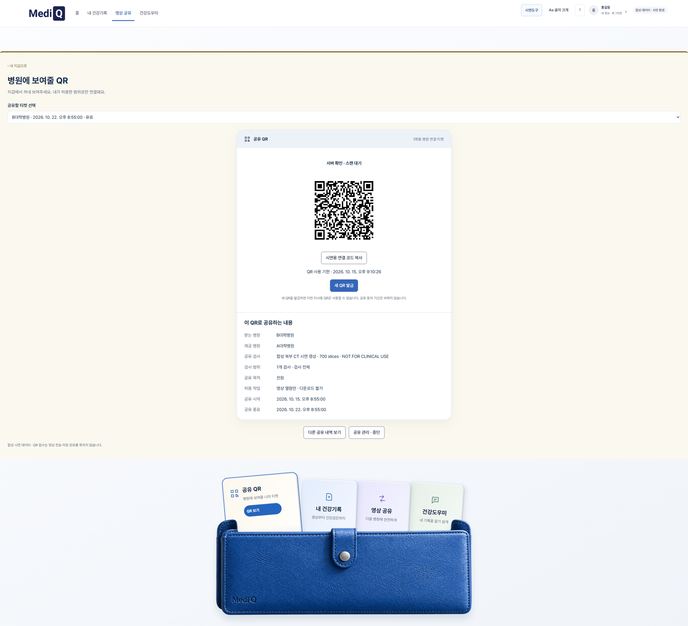
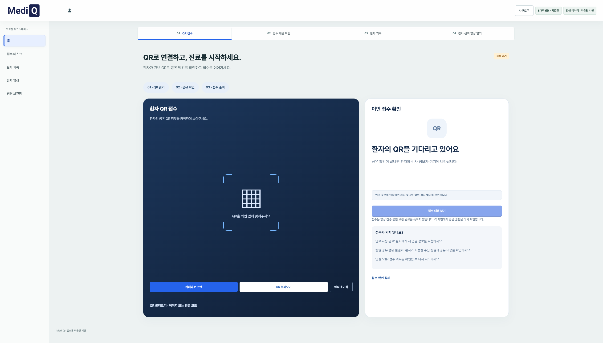
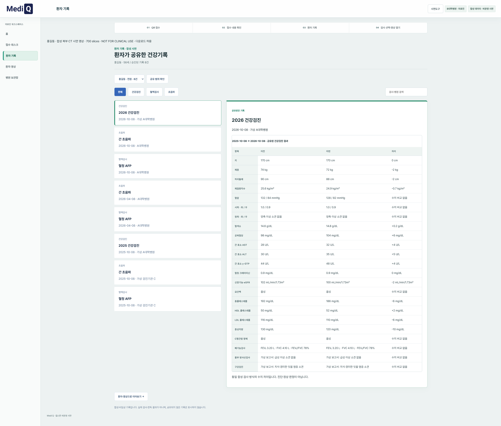
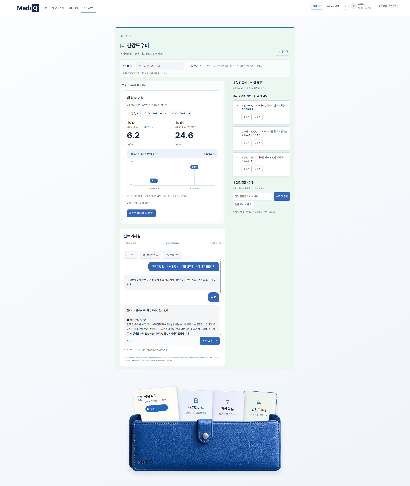
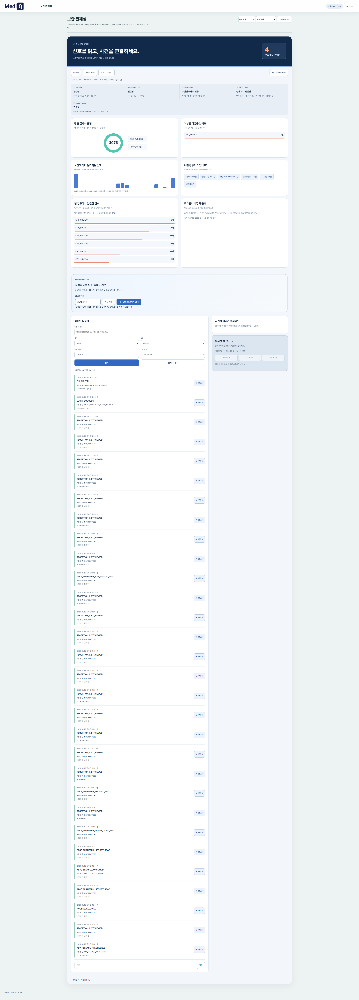

# Medi Q 시연 화면 안내

[화면 모음 열기](https://sureasdufo1-hue.github.io/Highpass-Project/presentation/gallery.html) · [Azure 웹](https://highpass-demo.japaneast.cloudapp.azure.com/hipass/) · [환자 모바일](https://highpass-demo.japaneast.cloudapp.azure.com/mobile/)

공개 자료 기준: 2026-10-17. 아래 자료는 사용자가 제공한 합성 시연 캡처입니다. 캡처 날짜가 확인되지 않은 이미지에 새 날짜를 붙이지 않았습니다. 로그인 계정 선택 화면, 중복 화면과 내부 리소스 화면은 소개 갤러리에서 제외했습니다.

## 시연 순서

환자가 공유 조건을 정하고 QR를 제시합니다. 의료진은 티켓으로 접수한 뒤 서버의 동의·역할·병원·기간·범위 검증을 거쳐 기록과 영상에 접근합니다. QR 접수 성공은 영상 열람이나 병원 보관 완료를 뜻하지 않습니다.

## 환자 건강지갑

검사와 공유 내역을 확인하고 필요한 메뉴로 이동합니다.

## 공유 조건 선택

검사·병원·목적·권한·기간을 정합니다.

## 환자 공유 QR

병원에 보여줄 티켓과 공유 내용을 확인합니다. 캡처의 QR는 만료됐습니다.

## 의료진 접수

환자가 제시한 QR 티켓으로 접수합니다. 영상 접근은 별도 권한 검증을 거칩니다.

## 공유된 건강기록

환자가 공유한 기록을 확인합니다.

## 합성 CT 뷰어

승인된 영상 범위를 열람합니다. 화면만으로 700장 전량 전송·무결성 검증을 주장하지 않습니다.

## 건강도우미

검사 기록 비교와 진료 질문 정리를 돕습니다. 진단·치료 판단 기능이 아닙니다.

## 보안관제실

접근 기록 검색과 기간별 보고서를 확인합니다. 표시 수치는 캡처 시점의 선택 기간에 해당합니다.

## 현재 상태와 과거 기록

- [현재 구성과 검증 범위](../architecture/current-demo-20261017.md)
- [화면 출처·원본 SHA-256](../assets/portfolio-20261017/manifest.json)
- [문서 안내](../README.md)

이전 24종 갤러리의 설명·계정 화면을 현행 소개로 재사용하지 않습니다. 원본 파일과 과거 문서는 개발 이력으로 보존합니다. 모바일 QR 제시 예시는 기존 티켓 화면을 발췌한 배치이며 실제 모바일 캡처가 아닙니다. 실기기·카메라 스캔·전체 전송 검증은 별도로 확인해야 합니다.
