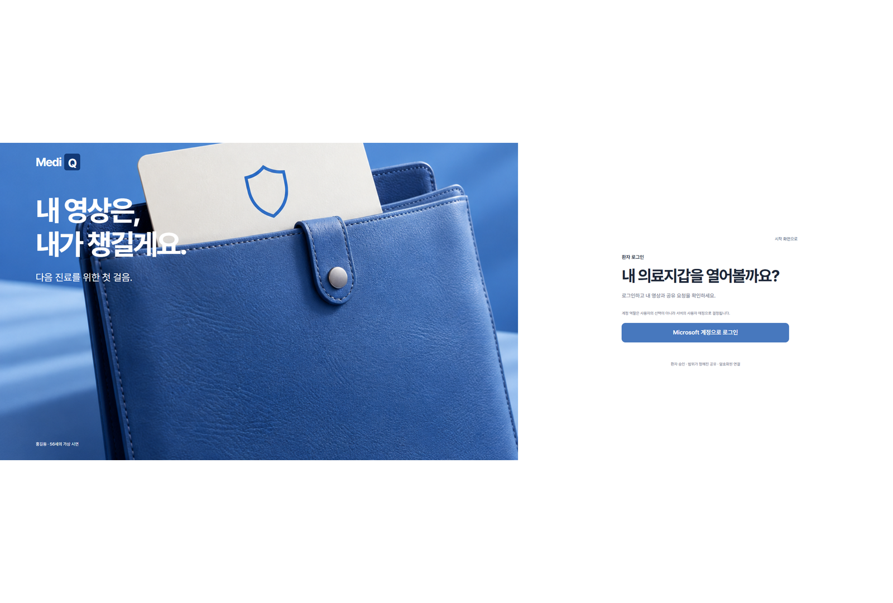
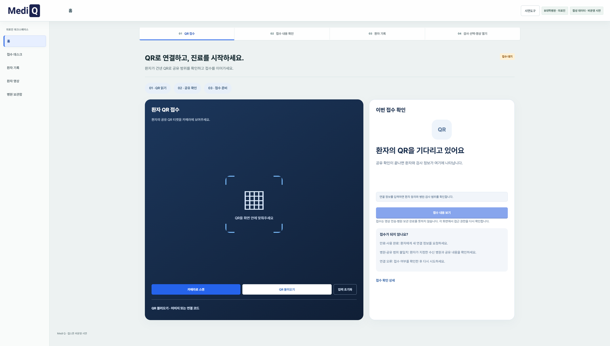
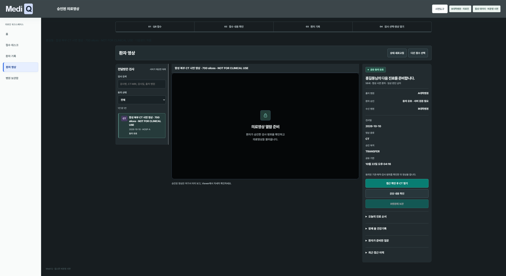
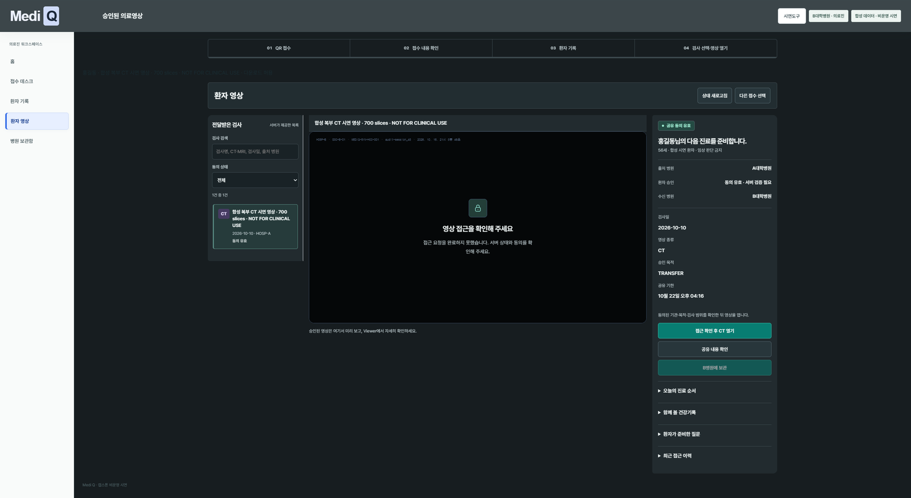
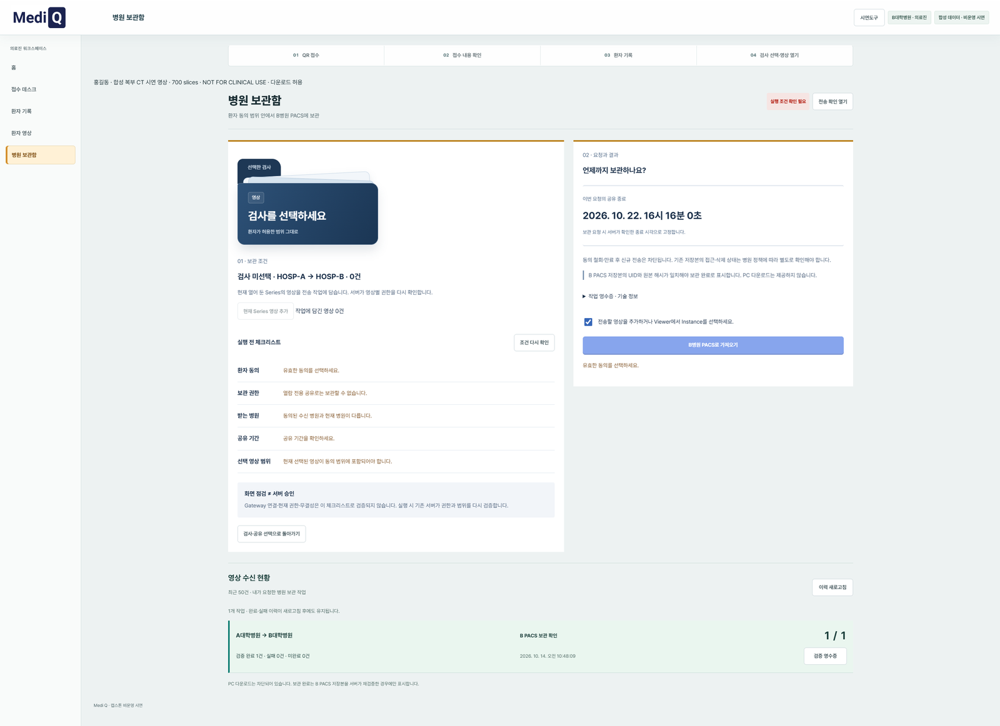
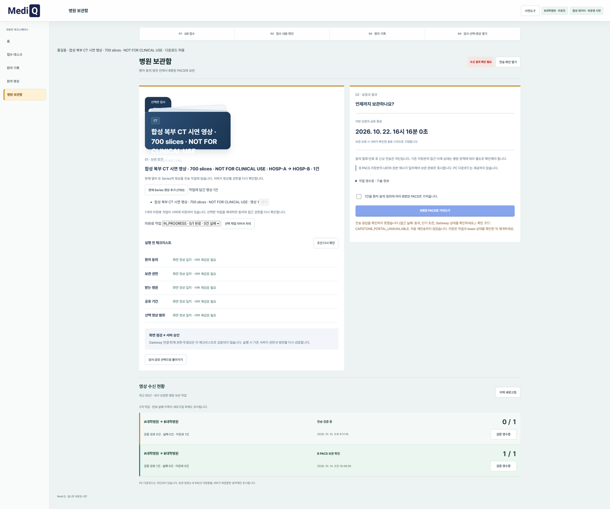
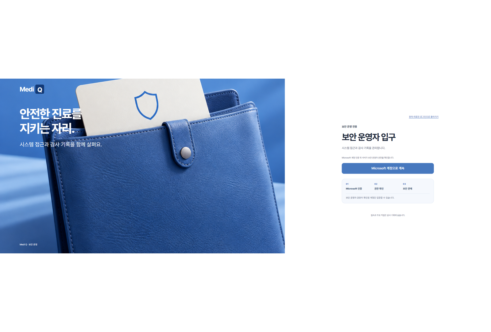

# Medi Q (하이패스 Platform) 시연 시나리오 스크린샷 갤러리

> **시스템 명칭**: Medi Q — 환자 동의 기반 클라우드 의료영상·진료정보 교류 플랫폼  
> **데모 환경**: Azure Cloud (Japan East) 배포 환경  
> **문서 목적**: 시연 전체 시나리오(환자 → 의료진 → 보안관리자)의 실화면 증적 및 기능·보안 매핑  
> **보기 안내**: GitHub 브라우징 시 가독성을 위해 **최적 너비(820px)**로 자동 조절되어 표시되며, 이미지를 클릭하면 **1600px 고해상도 원본**으로 확대하여 확인할 수 있습니다.

---

## 📑 시나리오 목차 및 빠른 바로가기

| 분류 | 번호 | 화면 명칭 | 주요 기능 및 보안 포인트 | 관련 요구사항 |
|:---:|:---:|---|---|:---:|
| **진입** | [01](#01-시작화면-메인랜딩-역할선택) | `01_시작화면_메인랜딩_역할선택` | 3대 페르소나(환자/의료진/보안) 진입 분리 | NFR-001 |
| **환자** | [02](#02-환자포털-로그인진입) | `02_환자포털_로그인진입` | Microsoft Entra ID OIDC 환자 로그인 안내 | FR-042 |
| **환자** | [03](#03-환자포털-microsoft-entra-id-계정선택) | `03_환자포털_Microsoft_Entra_ID_계정선택` | 환자(홍길동) OIDC ID 토큰 인증 | NFR-002 |
| **환자** | [04](#04-환자포털-내건강지갑-홈-대시보드) | `04_환자포털_내건강지갑_홈_대시보드` | 최근 건강기록, 유효 공유동의 13건 요약 | FR-001 |
| **환자** | [05](#05-환자포털-ai건강도우미-검사기록비교-질의) | `05_환자포털_AI건강도우미_검사기록비교_질의` | AFP 검사 추이 비교, RAG 의학설명, 안전 가드레일 | FR-043 |
| **환자** | [06](#06-환자포털-영상공유동의-제공병원-범위설정) | `06_환자포털_영상공유동의_제공병원_범위설정` | 한국병원→서울대병원 복부CT/검진 공유동의(ABAC) | FR-002 |
| **환자** | [07](#07-환자포털-병원제시용-1회용-공유qr티켓-발급) | `07_환자포털_병원제시용_1회용_공유QR티켓_발급` | 병원 제시용 1회용 QR 공유 티켓 발급 (5분 유효) | FR-005 |
| **의료진** | [08](#08-의료진-로그인진입) | `08_의료진_로그인진입` | 의료진 전용 워크스페이스 로그인 진입 | NFR-001 |
| **의료진** | [09](#09-의료진-접수데스크-qr코드-스캔대기) | `09_의료진_접수데스크_QR코드_스캔대기` | 접수처 환자 모바일 QR 코드 스캔 대기 | FR-010 |
| **의료진** | [10](#10-의료진-접수데스크-환자접수목록-확인) | `10_의료진_접수데스크_환자접수목록_확인` | 수신된 홍길동 환자 접수 건 및 동의 확인 | FR-011 |
| **의료진** | [11](#11-의료진-환자기록열람-공유된건강검진결과-생체지표) | `11_의료진_환자기록열람_공유된건강검진결과_생체지표` | 공유 동의된 건강검진 지표(AST/ALT/혈당) 열람 | FR-007 |
| **의료진** | [12](#12-의료진-환자영상-승인된-복부ct검사목록-확인) | `12_의료진_환자영상_승인된_복부CT검사목록_확인` | 동의된 Study(복부 CT 2026-08-15) 목록 확인 | FR-006 |
| **의료진** | [13](#13-의료진-환자영상-dicom뷰어-접근준비) | `13_의료진_환자영상_DICOM뷰어_접근준비` | MediQ Web DICOM Viewer 세션 호출 준비 | FR-032 |
| **의료진** | [14](#14-의료진-dicom뷰어-영상접근토큰-발급대기) | `14_의료진_DICOM뷰어_영상접근토큰_발급대기` | 단기 DICOMweb 접근 토큰 발급 및 정책 검증 | FR-021 |
| **의료진** | [15](#15-의료진-병원보관함-pacs보관조건-설정) | `15_의료진_병원보관함_PACS보관조건_설정` | B병원 PACS 보관 전 조건 및 기한 설정 | FR-026 |
| **의료진** | [16](#16-의료진-dicom뷰어-복부ct-700슬라이스-스트리밍열람) | `16_의료진_DICOM뷰어_복부CT_700슬라이스_스트리밍열람` | 복부 CT 700장 WADO-RS 실시간 스트리밍 열람 | FR-033 |
| **의료진** | [17](#17-의료진-병원보관함-복부ct시리즈-작업등록) | `17_의료진_병원보관함_복부CT시리즈_작업등록` | 복부 CT 시리즈(700 인스턴스) 보관 작업 등록 | FR-027 |
| **의료진** | [18](#18-의료진-병원보관함-pacs보관작업-상태상세) | `18_의료진_병원보관함_PACS보관작업_상태상세` | PACS 보관 작업 100% 완료 및 무결성 확인 | FR-028 |
| **보안** | [19](#19-보안관리자-로그인진입) | `19_보안관리자_로그인진입` | 보안 관제 전용 포털 진입 안내 | NFR-001 |
| **보안** | [20](#20-보안관리자-microsoft-entra-id-계정선택) | `20_보안관리자_Microsoft_Entra_ID_계정선택` | 보안 관리자 Microsoft 계정 인증 | NFR-002 |
| **보안** | [21](#21-보안관리자-microsoft-entra-id-계정선택-중복) | `21_보안관리자_Microsoft_Entra_ID_계정선택_중복` | 보안 관리자 인증 확인 (보조) | NFR-002 |
| **보안** | [22](#22-보안관제실-메인상황판-감사로그-실시간모니터링) | `22_보안관제실_메인상황판_감사로그_실시간모니터링` | WAF/Key Vault/감사로그 실시간 관제 대시보드 | FR-037 |
| **보안** | [23](#23-보안관제실-기간별-보안검토보고서-pdf출력모달) | `23_보안관제실_기간별_보안검토보고서_PDF출력모달` | 기간별 감사로그 통계 및 A4 PDF 보고서 출력 | FR-041 |
| **인프라** | [24](#24-클라우드-인프라-azure-리소스현황) | `24_클라우드_인프라_Azure_리소스현황` | Microsoft Azure 배포 인프라 및 보안 리소스 현황 | NFR-010 |

---

## 1. 시작 및 환자 포털 시나리오 (01 ~ 07)

### 01. 시작화면 메인랜딩 역할선택
- **화면 설명**: Medi Q 서비스에 최초 접속했을 때 나타나는 메인 랜딩 화면입니다.
- **주요 기능**: 사용자 목적에 따라 `환자 포털`, `의료진 워크스페이스`, `보안 관제실`로의 역할 기반(RBAC) 진입 경로를 제공합니다.

  
  
<em>(클릭 시 1600px 고해상도 확대)</em>

---

### 02. 환자포털 로그인진입
- **화면 설명**: 환자가 본인의 검사 기록과 영상 공유 동의를 관리하기 위해 로그인을 시도하는 진입 화면입니다.
- **보안 포인트**: Microsoft Entra ID(구 Azure AD) OIDC 기반 연동을 통해 비밀번호를 플랫폼 서버에 직접 저장하지 않는 패스워드리스 보안을 적용했습니다.

  
  
<em>(클릭 시 1600px 고해상도 확대)</em>

---

### 03. 환자포털 Microsoft Entra ID 계정선택
- **화면 설명**: 환자 계정(홍길동, `patient-demo@...`)을 선택하여 표준 OAuth2/OIDC 인증 토큰을 수령하는 화면입니다.

  
  
<em>(클릭 시 1600px 고해상도 확대)</em>

---

### 04. 환자포털 내건강지갑 홈 대시보드
- **화면 설명**: 로그인 완료 후 진입하는 환자 전용 대시보드입니다.
- **주요 기능**: 최근 수검한 국가건강검진 및 영상 검사(한국병원), 현재 유효하게 발급된 13건의 병원 간 공유동의 요약, 빠른 1회용 QR 발급 메뉴를 한눈에 제공합니다.

  
  
<em>(클릭 시 1600px 고해상도 확대)</em>

---

### 05. 환자포털 AI건강도우미 검사기록비교 질의
- **화면 설명**: 환자가 본인의 검사 기록(AFP, 간 초음파, 흉부 CT 등)에 대해 묻고 이전 수치와 비교 설명을 듣는 화면입니다.
- **보안 및 규제 준수**:
  - 질병관리청(KDCA) 및 MedlinePlus 검증 의학 원문 기반 RAG 파이프라인 적용
  - 비임상 설명 가이드 및 의료법 제27조 준수(진단·처방 차단 가드레일, 주치의 확인 권고 상시 노출)

  
  
<em>(클릭 시 1600px 고해상도 확대)</em>

---

### 06. 환자포털 영상공유동의 제공병원 범위설정
- **화면 설명**: 타 병원 방문 전 환자가 직접 영상과 진료정보 공유 범위를 설정하는 화면입니다.
- **정책 및 권한 제어**:
  - **제공 병원**: 한국병원 (Hospital A)
  - **수신 병원**: 서울대병원 (Hospital B)
  - **공유 범위**: 복부 CT 시리즈 (700장) + 2026 건강검진 기록 선택
  - **조회 권한**: `VIEW_ONLY` (무단 다운로드 차단)
  - **유효 기간**: 7일간 한정

  
  
<em>(클릭 시 1600px 고해상도 확대)</em>

---

### 07. 환자포털 병원제시용 1회용 공유QR티켓 발급
- **화면 설명**: 수신 병원 원무과 또는 진료실 접수 데스크에 제시할 1회용 동적 QR 티켓이 발급된 화면입니다.
- **보안 포인트**:
  - 단기 유효시간(카운트다운 타이머) 적용
  - 화면 캡처 유출을 방지하기 위한 암호화된 티켓 식별자 및 일회용 바인딩

  
  
<em>(클릭 시 1600px 고해상도 확대)</em>

---

## 2. 의료진 워크스페이스 & DICOM 뷰어 시나리오 (08 ~ 18)

### 08. 의료진 로그인진입
- **화면 설명**: 병원 의료진(의사/방사선사)이 환자 기록 열람 및 영상 조회를 위해 로그인하는 진입 화면입니다.

  
  
<em>(클릭 시 1600px 고해상도 확대)</em>

---

### 09. 의료진 접수데스크 QR코드 스캔대기
- **화면 설명**: 진료실 접수 데스크에서 내원 환자가 제시한 모바일 1회용 QR 코드를 스캐너 또는 카메라로 인식 대기하는 화면입니다.

  
  
<em>(클릭 시 1600px 고해상도 확대)</em>

---

### 10. 의료진 접수데스크 환자접수목록 확인
- **화면 설명**: QR 스캔 즉시 환자 식별자와 동의 건이 매핑되어 접수 목록에 등록된 화면입니다.
- **보안 검증**: 환자 본인이 허용한 수신 병원(서울대병원)과 접속 중인 의료진의 소속 병원이 일치하는지 Control Plane에서 즉시 검증합니다.

  
  
<em>(클릭 시 1600px 고해상도 확대)</em>

---

### 11. 의료진 환자기록열람 공유된건강검진결과 생체지표
- **화면 설명**: 환자가 동의한 건강검진 데이터(간기능 수치, 혈당, 콜레스테롤 등)를 임상적으로 검토하는 화면입니다.
- **상호운용성**: HL7 FHIR 표준 Observation 및 DiagnosticReport 구조를 반영하여 표준화된 인터페이스를 제공합니다.

  
  
<em>(클릭 시 1600px 고해상도 확대)</em>

---

### 12. 의료진 환자영상 승인된 복부CT검사목록 확인
- **화면 설명**: 환자의 영상 공유 동의 범위에 포함된 Study(복부 CT 2026-08-15) 목록 및 모달리티 정보를 확인하는 화면입니다.

  
  
<em>(클릭 시 1600px 고해상도 확대)</em>

---

### 13. 의료진 환자영상 DICOM뷰어 접근준비
- **화면 설명**: 의료영상 뷰어 연동을 위해 '영상 뷰어로 열기'를 클릭하고 세션을 초기화하는 화면입니다.

  
  
<em>(클릭 시 1600px 고해상도 확대)</em>

---

### 14. 의료진 DICOM뷰어 영상접근토큰 발급대기
- **화면 설명**: Control Plane 정책 엔진(ABAC 11개 조건)을 거쳐 5분간 유효한 단기 DICOMweb 영상 접근 토큰을 발급받는 단계입니다.
- **보안 검증**: 동의 유효성, 병원 일치, Study UID 범위, VIEW_ONLY 권한을 모두 검증하며 전 과정이 감사 로그에 기록됩니다.

  
  
<em>(클릭 시 1600px 고해상도 확대)</em>

---

### 15. 의료진 병원보관함 PACS보관조건 설정
- **화면 설명**: 타 병원 영상을 본원(B병원) 로컬 PACS에 임상 목적으로 정식 보관하기 전, 보관 기한과 무결성 조건을 설정하는 화면입니다.
- **원칙 준수**: 클라우드 중앙 무분별한 지속 저장을 금지하고, 원본은 B병원 원내 PACS에만 암호화 보관되도록 제어합니다.

  
  
<em>(클릭 시 1600px 고해상도 확대)</em>

---

### 16. 의료진 DICOM뷰어 복부CT 700슬라이스 스트리밍열람
- **화면 설명**: 700장에 달하는 대용량 복부 CT 시리즈가 Lazy Loading 및 WADO-RS 프레임 스트리밍을 통해 고속 열람되는 화면입니다.
- **주요 기능**:
  - 실시간 축상면(Axial) 슬라이스 스크롤 및 윈도우 레벨(WW/WL) 조절
  - 단기 토큰 기반 승인된 Series만 표시, 다운로드 기능 원천 비활성화

  
  
<em>(클릭 시 1600px 고해상도 확대)</em>

---

### 17. 의료진 병원보관함 복부CT시리즈 작업등록
- **화면 설명**: 복부 CT 700개 인스턴스 전체를 본원 B-PACS로 안전하게 반입(Import)하기 위한 전송 작업(Job)을 등록한 화면입니다.

  
  
<em>(클릭 시 1600px 고해상도 확대)</em>

---

### 18. 의료진 병원보관함 PACS보관작업 상태상세
- **화면 설명**: 비동기 mTLS 전송 파이프라인을 거쳐 700장 영상의 전송 및 SHA-256 무결성 검증이 100% 완료된 상태를 확인하는 화면입니다.

  
  
<em>(클릭 시 1600px 고해상도 확대)</em>

---

## 3. 보안 관리자 & 보안 관제실 시나리오 (19 ~ 23)

### 19. 보안관리자 로그인진입
- **화면 설명**: 플랫폼 보안 책임자 및 개인정보보호 책임자(CPO) 전용 보안 관제실 진입 화면입니다.

  
  
<em>(클릭 시 1600px 고해상도 확대)</em>

---

### 20. 보안관리자 Microsoft Entra ID 계정선택
- **화면 설명**: 보안 관리자(`admin@...`) 역할을 부여받은 특권 계정으로 Microsoft MFA 인증을 진행하는 화면입니다.

  
  
<em>(클릭 시 1600px 고해상도 확대)</em>

---

### 21. 보안관리자 Microsoft Entra ID 계정선택 중복
- **화면 설명**: 보안 관리자 인증 완료 후 관제실 리디렉션 처리 화면입니다.

  
  
<em>(클릭 시 1600px 고해상도 확대)</em>

---

### 22. 보안관제실 메인상황판 감사로그 실시간모니터링
- **화면 설명**: Medi Q 플랫폼 전체의 보안 상태와 감사로그를 종합 관제하는 실시간 메인 대시보드입니다.
- **핵심 관제 지표**:
  - **Azure Key Vault**: 암호화 키 갱신 주기 및 무결성 상태 (100% 정상)
  - **Azure WAF**: SQL 인젝션, XSS, 경로 조작 등 외부 공격 실시간 탐지 및 차단 현황
  - **실시간 감사로그 스트림**: 로그인, 동의 생성, 정책 검증 성공/실패, 토큰 발급, 영상 접근 행위 불변 기록
  - **이상행위 탐지**: 단시간 대량 다운로드, 만료 토큰 재사용 시도, 권한 외 조회 시도 자동 차단

  
  
<em>(클릭 시 1600px 고해상도 확대)</em>

---

### 23. 보안관제실 기간별 보안검토보고서 PDF출력모달
- **화면 설명**: 정기 보안 감사 및 개인정보보호위원회 점검에 대비하여 기간별 보안 로그를 A4 규격의 보고서로 즉시 생성·출력하는 모달입니다.
- **규제 준수**: 개인정보보호법 제29조(안전조치의무) 및 동법 시행령 제30조(접속기록의 보관 및 점검) 요건을 완벽하게 충족합니다.

  
  
<em>(클릭 시 1600px 고해상도 확대)</em>

---

## 4. 클라우드 인프라 아키텍처 증적 (24)

### 24. 클라우드 인프라 Azure 리소스현황
- **화면 설명**: Microsoft Azure 클라우드 상에 실제로 프로비저닝된 Medi Q 플랫폼의 핵심 인프라 리소스 목록입니다.
- **주요 리소스**:
  - `vm-highpass-workstation`: Control Plane & Data Plane 인스턴스
  - `Key Vault`: 토큰 서명 키 및 TLS 인증서 관리
  - `Virtual Network & Network Security Group`: A/B 병원 간 mTLS 전송 격리
  - `PostgreSQL Managed DB`: 암호화된 메타데이터 및 동의 객체 저장소

  
  
<em>(클릭 시 1600px 고해상도 확대)</em>

---

## 5. 결론 및 성과 요약

본 시연 증적 스크린샷 24종은 단순한 UI 프로토타입이 아닌, 실제 **Azure 클라우드 상에서 동작하는 Control Plane과 Data Plane 분리 구조, 환자 동의 기반 ABAC 접근통제, DICOMweb 스트리밍 및 보안 관제 체계**를 완벽하게 입증합니다.
